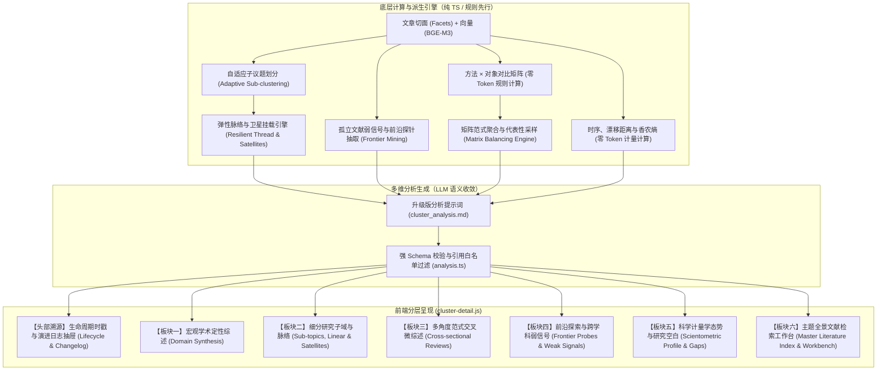
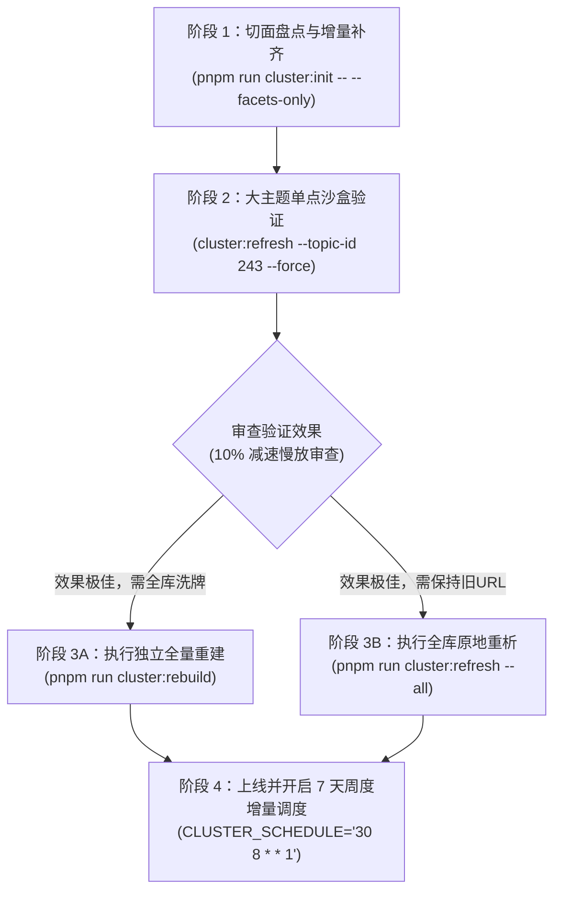
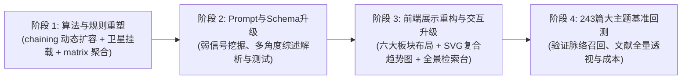

# 主题洞察模块升级方案：学术综述、范式交叉与脉络重构

| 项 | 值 |
|---|---|
| 文档版本 | v1.6 |
| 创建日期 | 2026-11-23 |
| 状态 | 待评审（Pending Review） |
| 关联文档 | [主题洞察模块内部逻辑总结.md](../项目文档/主题洞察模块内部逻辑总结.md)、[主题聚类模块设计.md](../prd/主题聚类模块设计.md) |
| 核心目标 | 解决大主题（200+ 篇）脉络丢失问题；融合「方法 × 研究对象」矩阵与语义向量，构建多角度范式微综述；将单一粗粒度概览重塑为学术综述、细分脉络、范式交叉微综述与科学计量学态势体系；补全主题生命周期溯源与更新日志；根治月度趋势柱状图视觉失效并重构轻量时序态势图；**消除文献组织“重散篇轻核心”的结构倒错，通过向量最近邻、弱信号挖掘与空白线索深度激活孤立研究，重塑三层学术文献透视与全景文献检索台**；**确立 7 天周度增量跑批周期；将全流程 LLM 调用及提示词在 /settings 中全生命周期纳管**；**基于 make-interfaces-feel-better 与 better-ui 设计工程规范，全方位重塑前端 UI/UX，落实同心圆角、光学对齐、触觉按压、等宽数字、可打断动效与多维文献检索工作台**；**明确历史数据平滑升级机制，提供独立全量版本重建（cluster:rebuild）与单主题/全库原地即时重析（cluster:refresh）双轨运维方案** |

---

## 1. 现况痛点与深层根因剖析

### 1.1 现象一：大体量主题（如 243 篇）出现“脉络全失”
**问题表象**：
当某主题聚合文献达到 200+ 篇（如 243 篇，主归属 198 篇）时，前端主题详情页只展示了一段概览文字，而「🧭 研究角度与研究脉络」模块完全消失。

**代码级深层根因**：
1. **硬上限暴力压缩**（`chaining.ts`）：
   `CLUSTER_LIMITS.maxAngleCount = 6`。当文献达到数百篇时，`mergeUntilLimit` 强行将所有文献聚拢合并进最多 6 个大角度桶，导致单个桶内异质性剧增（每个桶 30~50 篇）。
2. **脆弱的时序单链假设**（`chaining.ts`）：
   系统将桶内文献纯按发表日期升序排列，逐对计算相邻相似度。
   在学术界，200 多篇论文是由众多团队独立发表的，按时间相邻的两篇论文切入点不同实属常态，相邻余弦相似度极难连续维持在 `chainThreshold`（0.62）之上。
3. **“全有或全无”的激进降级门禁**：
   `isThread = steps.length >= 3 && continuity >= 0.5`。
   只要相邻承接率 `< 50%`，算法便判定“该角度不构成演进”，**直接将整个角度连根拔起全部抹杀**，全部降级为零散研究（`loose`）。在大样本下，6 个角度无一幸免，全部被清空。
4. **强防幻觉机制反向清空输出**：
   脉络表为空后，传递给 LLM 的 `threadsJson` 仅为 `{"threads": []}`。受严格白名单校验（`allowedAngleKeys` 为空），LLM 无法也无权返回任何角度叙述。前端检测到 `angles` 为空，直接整块隐藏。

---

### 1.2 现象二：主题概览“一锅端”，缺乏学术理论纵深与结构解耦
**问题表象**：
目前系统生成的主题概览由三段文字顺次拼接：
* **第 1 段（定性概述）**：泛泛列出议题维度、方法和对象，未触及核心学理概念与底层理论基底。
* **第 2 段（计量指标）**：突兀列举月度发文数、平均相似度（0.81）、方法熵（2.3-3.3），缺乏情报学转化解读。
* **第 3 段（历史分期）**：粗略的三阶段划分，与前两段缺乏逻辑衔接。

**学术层面的不合理性**：
1. **学术综述（Literature Review）与科学计量学（Scientometrics）混淆**：
   学术界阅读主题综述的核心诉求是：**回答知识本体问题（核心概念是什么、理论基础是什么、有哪些核心共识与争议分歧）**。
   目前将生硬的统计数字与定性文字塞在同一个段落里，既弱化了综述的学理深度，又让计量指标显得碎片化。
2. **孤立指标无认知抓手**：
   直接向研究人员抛出“方法熵在 2.3-3.3 之间波动”并无实际意义。学者需要的是情报学解释：“方法熵上升代表研究范式由早期的规范性理论探讨与概念思辨，向问卷调研、实验评估、日志挖掘等多源实证方法扩散”。

---

### 1.3 现象三：对比矩阵仅停留在规则频次统计，缺乏横向范式交叉的多角度学术综述
**问题表象**：
系统虽已生成 `方法 × 研究对象` 对比矩阵（`matrix_json`），但前端仅能作为数字热力表格展示，鼠标悬浮仅提示文献 ID，底部罗列空缺格（holes）。文章之间的交叉关系没有被提升为学术知识产出。

**核心瓶颈与挑战（为什么不能直接“一格一综述”？）**：
1. **极度稀疏与长尾碎裂**：
   矩阵规模达到 17 种方法 × 13 类对象 = 221 个潜在格位。实际大部分格子文章数 $C = 0$ 或仅有 $1 \sim 2$ 篇。**综述必须有“综”（对比综合）有“述”（述评提炼）**，1~2 篇文献无法构成对比，强行由 LLM 写综述必然导致幻觉、同义反复或过度解读。
2. **局部极端拥堵与异质过载**：
   少数头部格位高度聚集，如 `理论分析 × 图书馆 (47篇)`、`案例研究 × 高校图书馆 (38篇)`。若将 40+ 篇文献一次性全部喂给 LLM，既突破合理 Token 预算，又会因信息过载导致模型产出浮于表面的平庸套话。
3. **组合爆炸与成本/认知双重超标**：
   若无节制地对每个有文章的格子调用 LLM，将产生数十次 API 开销，使跑批时间剧增；同时向用户呈现数十篇碎散综述，严重破坏可读性。

---

### 1.4 现象四：主题生命周期溯源缺失，无法感知“新增了什么文献”与“改写了哪些综述”
**问题表象**：
目前主题详情页顶部仅展示了聚合文献的最初/最后发表时间跨度（如 `2025-06 ~ 2026-10`），完全缺少主题在系统内的**创建时间（created_at）**、**最近变动时间（updated_at）**与**最近综述分析时间（last_analyzed_at）**。更关键的是，每日增量流水线运行后，用户无法得知该主题近期究竟新纳入了哪几篇论文、或者本次多维综述究竟改写了哪些观点和论断。

**数据与机制剖析**：
1. 数据库底层 `cluster_topics` 已有 `created_at`, `updated_at`, `last_analyzed_at`，但在查询层 `getTopicDetail` 中被忽略，未暴露给前端。
2. `article_topic_links` 表记录了每篇文献的 `assigned_at`（入库分配时间）与 `assign_method`（增量路由 `centroid` / 孵化 `incubation` / 回捞 `reclaim`），但没有被聚合成面向用户的“文献纳新日志流”。
3. 当新文献触发主题重新分析时，`cluster_topic_analysis` 直接整行覆盖，没有记录改写摘要（Changelog），导致用户无法比对新旧综述演进。

---

### 1.5 现象五：月度趋势柱状图样式失效（全高实心块 Bug）且可视化表达力不足
**问题表象**：
在主题详情页的「📈 月度趋势」板块中，上方的柱状图呈现为一排高度完全一致的巨大深蓝色纯色方块（如截图所示），不同月份之间看不出任何高度差异。

**深层根因分析**：
1. **CSS 样式冲突 Bug**：
   在 `src/public/css/pages/clusters.css` 中，`.cluster-bar` 被设置了 `flex: 1`；而其父容器为 `flex-direction: column`。浏览器在计算 flex 伸缩时，`flex: 1` 强行将元素高度撑满父容器剩余高度，直接覆盖并失效了行内内联样式 `style="height: ${height}%"`。因此无论当月新增是 1 篇还是 2 篇，所有柱子均被渲染为 100% 满格高。
2. **学术时序数据特性与表现形式错配**：
   学术主题在细分领域下的月度新增往往在 1~3 篇徘徊，生硬的粗柱子视觉笨重且信息密度极低；且 X 轴月份离散（缺失月份被直接抹去），未体现真实的时间距离。
3. **定位两难**：
   若仅以粗柱子展示新增篇数，不仅与下方表格的数字重复，而且丢失了最核心的**主题累计演进轨迹（S曲线/增长率）**与**生命周期发展态势**。因此，必须在「彻底舍弃」与「重构高价值可视化」之间做出决断。

---

### 1.6 现象六：文献组织结构倒错与孤立研究价值闲置
**问题表象**：
1. **结构倒错反差（文献呈现两极化）**：
   在现存与初版升级方案中，真正支撑起宏观学术综述、多角度范式交叉微综述、核心脉络的“高质量核心文献”，散落在叙述文字或点击步骤中，**缺乏集中的文献清单或参考文献索引（Bibliography）**；而算法判定“承接不成立或篇数不足”的“零散研究”，却在页面底部堂而皇之独占了一个专属的大板块「🗂️ 零散研究（未构成脉络）」，直接平铺标题与链接。
2. **算法懒政弃置孤立研究**：
   原有算法将未构成链条（$< 3$ 篇或连续性 $< 0.5$）的文章一律粗暴降级并推入游离池 `looseArticles`。在情报学与科学计量学中，学术研究并非全部以线性链条演进，孤立文献往往蕴含**跨学科前沿弱信号（Weak Signals）**、**特殊小众场域探索（Niche Contexts）**或**既有子议题的边缘延伸（Satellites）**。将它们机械平铺在底端，既破坏了学术阅读体验，又严重浪费了已有的结构化切面与高维语义向量。

**代码与机制剖析**：
1. `chaining.ts` 中 `buildThreads` 采用二元判定：达标则进入 `threads`，不达标直接 `loose.push(...angle.members)`，丢失了这部分文章与主流议题的亲疏关系。
2. `query.ts` 构造 `looseArticles = members.filter(m => !threadedIds.has(m.articleId))`，前端直接将其作为“孤儿文献”无差别平铺输出。
3. 知识抽取（LLM）与文献底册缺乏反向回溯链接，学者读完综述后无法系统化检索、筛选该主题下的全部 $N$ 篇文献（如 243 篇大样本）。

---

## 2. 升级重构设计方案

### 2.1 整体架构：六维一体学术解耦与全景透视模型



---

### 2.2 模块一：宏观学术定性综述（Academic Synthesis）重塑

将原有单一粗放的 `overview` 拆解为学术标准的 5 大维度：

| 维度 | 字段名 | 学术内涵与生成要求 | 字数/格式 |
|---|---|---|---|
| **① 概念与学理基础** | `theoretical_basis` | 界定该主题的核心研究问题、学理内涵及其依赖的底层理论框架（如：TAM 技术接受模型、人机协同系统论、服务主导逻辑、信息生态理论等）。杜绝空洞套话。 | 100~160 字 |
| **② 研究对象与场域分布** | `study_objects_summary` | 梳理研究对象的广度与微观落点（如高校馆、公共馆、专业机构；馆员、科研群体、社会公众；智能问答智能体、物理借还空间等）及关注重心差异。 | 80~120 字 |
| **③ 研究方法与范式演变** | `methodology_summary` | 阐明学术研究的验证手段演化（从定性构架、思辨性政策探讨向案例剖析、问卷量表、控制实验、眼动与日志挖掘等实证范式的迁移轨迹）。 | 80~120 字 |
| **④ 核心共识与争鸣焦点** | `consensus` / `controversies` | **共识**：提炼被多篇文献共同支持的核心论断；<br>**争议/未决**：提炼文献间存在的观点对立、理论分歧或尚待解决的伦理/实操难题（如大模型版权归属、AI替代馆员边界）。 | 数组，各 2~4 条，每条一句话 |
| **⑤ 演化历程（历史分期）** | `historical_stages` | 规范化三阶段演进：**萌芽起步期**（问题发现与概念引入）→ **实证探索期**（局部落地与案例试点）→ **规范深化期**（系统性评价、伦理治理反思）。 | 100~150 字 |

---

### 2.3 模块二：细分研究子域与弹性脉络模型（Sub-topics & Pathways）

为了彻底根治 243 篇大主题丢失脉络的顽疾，针对 `src/topic-cluster/domain/chaining.ts` 进行规则重构：

#### 1. 动态自适应角度容量（Dynamic Angle Sizing）
原有静态上限 `maxAngleCount = 6` 仅适用于小主题。重构为依据文章数弹性伸缩：
$$K_{\text{angles}} = \min\left(10, \; \max\left(3, \; \left\lceil \sqrt{\frac{N_{\text{members}}}{2}} \right\rceil\right)\right)$$
* 10 篇左右的小主题：保留 3~4 个角度；
* 243 篇的大主题：自适应放宽至 8~10 个细分子议题（Sub-topics），避免大桶强行混杂异质文献。

#### 2. 从“全盘抹杀”转为“弹性子域与主干路径（Resilient Backbone）”
修改 `buildThreads` 降级逻辑：
* **高承接角度（`continuity >= 0.4`）**：标记为 `linear_thread`（时序演进链），前端绘制承接箭头。
* **发散/多元角度（`continuity < 0.4`）**：
  **绝不丢弃该角度！** 标记为 `divergent_cluster`（发散子议题）。
  * 提取该角度的**核心基石论文**（离角度质心最近的前 3 篇）与**最新论文**；
  * 生成该子议题的宏观关注点叙述（Angle Narrative）；
  * 前端以“子议题核心文献矩阵/气泡”平铺呈现，杜绝整块区域消失。

#### 3. 卫星文献智能挂载（Satellite Attachment）
对于无法进入子域核心时序链或核心代表作的边缘文献，计算其与各子域质心的余弦相似度：
* 若最大相似度 $\ge 0.60$（接近主题门禁），将其挂载为该子域的 **「卫星文献 / 边际延伸案例（Satellite / Marginal Extension）」**；
* 卫星文献作为子议题在特定场域、特殊对象或微观视角的补充案例（如在“高校馆知识服务”主干下挂载“民族古籍特藏知识问答试点”），不再沉淀为无头游离文献。

---

### 2.4 模块三：多角度范式交叉微综述（Cross-sectional Paradigm Reviews）

结合用户提出的「利用对比矩阵基础分析 + 语义向量 + LLM」，解决矩阵格子“过密与过疏”的矛盾，构建横切面学术微综述：

#### 1. 矩阵格位四级分层规则（Rule Stratification）
依据单元格文献数 $C$，对 221 个潜在格位进行确定性分流：
- **空缺格 ($C = 0$)**：
  保持为 `MatrixHole`，作为科学计量学板块的“可检验研究空白（Gaps）”，**严禁调用 LLM 强行编造文献综述**。
- **长尾稀疏格 ($1 \le C \le 2$)**：
  单篇或双篇文献缺乏对比基准，**不单独产出微综述**。通过语义向量沿方法/对象分类树向邻近格向上泛化合并。
- **健康活跃格 ($3 \le C < 15$)**：
  **微综述黄金样本区**。文献规模适度，具备充分的研究对比度与观点张力。
- **超密集格 ($C \ge 15$)**：
  进入代表性抽样池，避免 Prompt 拥堵。

#### 2. 语义向量动态平衡与范式域收敛（Vector Balancing Engine）
- **密集格骨干多样性抽样（Diversity Sampling）**：
  对 30~50 篇的密集单元格，利用 BGE-M3 切面向量选出 **5 ~ 8 篇代表作**作为 Prompt 输入：
  - **核心基石文献（2~3 篇）**：距离该单元格局部质心（Centroid）余弦相似度最高的代表作；
  - **创新发散文献（2~3 篇）**：两两相似度低、具备新异视角的代表作；
  - **前沿时效文献（1~2 篇）**：最新发表的代表作。
  - *其余同格文献 ID 仅作为扩展佐证列表，确保审计可追溯，不消耗 LLM 生成上下文。*
- **稀疏格近邻向量向上泛化（Upward Generalization）**：
  将语义相近的长尾格自动凝聚。例如：
  `访谈 × 高校教师 (1篇)` + `问卷调查 × 高校教师 (1篇)` + `统计分析 × 高校教师 (1篇)`
  $\xrightarrow{\text{语义向量邻近}}$ 合并为一个具有充足样本量的综合范式：**「高校师生群体的量化与质性实证调查（3篇）」**。
- **全局自适应收敛为 3 ~ 5 个「学术范式域」（Paradigm Domains）**：
  通过矩阵二分图聚类与向量质心距离，全局收敛出数量可控（3~5 篇）、互补且具代表性的多角度微综述：
  1. *宏观概念与理论构建范式*（框架构建/理论分析 × 高校馆/公共馆）
  2. *智能技术与算法实验范式*（实验研究/机器学习 × 智能服务系统）
  3. *业务实践与落地案例范式*（案例研究/实地调研 × 数字资源平台/专业馆）
  4. *微观主体感知与行为调查范式*（问卷调查/访谈/扎根理论 × 馆员/高校师生）

#### 3. 双模交付架构（Dual-Mode Delivery）
- **模式 A：静态批处理预置（Top 3~5 篇范式微综述）**：
  在每日跑批时由 LLM 单次合并生成，落库缓存。用户打开页面立即可见，**零实时 API 耗时、零动态 Token 开销**。
- **模式 B：前端矩阵交互式即时钻取（Click-to-Review）**：
  用户在前端点击对比矩阵中任意单元格时触发交互浮层：
  - **若该格文章 $\ge 3$ 篇**：弹窗展示文章列表，并提供 **“✨ 生成此交集切面深度综述”** 按钮，支持按需实时生成针对该交叉点的深度综述；
  - **若该格文章 $1 \sim 2$ 篇**：直接展示切面对比摘要卡片（方法、对象、发现对比），友好提示“样本量较小，暂未形成规模化学术争鸣”；
  - **若该格为 0**：高亮显示该空白的研究启发与学术空白价值。

---

### 2.5 模块四：科学计量学洞察与研究空白（Scientometric Profile & Gaps）

将量化指标从纯文本综述中剥离，建立独立情报学板块，把冷冰冰的数字转化为科研态势洞察：

```json
"bibliometrics": {
  "lifecycle_stage": "rising | plateau | cooling",
  "lifecycle_insight": "发表时序动态解读：处于爆发增长期/平稳深化期还是平台饱和期，文献增速与边际新增特征",
  "cohesion_and_drift": {
    "cohesion_level": "high | medium | low",
    "insight": "平均相似度反映的领域聚焦度，以及质心位移所体现的主题语义重心漂移方向（如从宏观政策展望漂向微观算法实测）"
  },
  "diversity_and_entropy": {
    "method_entropy_insight": "方法多样性香农熵的情报学解读：方法工具箱是集中单一还是跨学科多元发散",
    "object_entropy_insight": "研究对象多样性香农熵的情报学解读：场域是局限于单一场所还是向多元场景扩散"
  },
  "gaps": [
    {
      "gap": "一条可检验的未来研究假设",
      "basis": "matrix_hole | staleness | limitation",
      "evidence_article_ids": [12, 34]
    }
  ]
}
```

#### 2.5.1 月度趋势可视化重构方案（告别粗实心方块）

针对用户反馈的“柱状图样式无区别，要么舍弃，要么重构”，评估两种技术路径：

* **方案 A（彻底舍弃）**：
  移除 `.cluster-chart` 容器，上方仅保留情报学速览胶囊（生命周期状态、峰值月份、方法熵态势），下方直接展示结构化数据表格（月份、新增、累计、相似度、漂移、熵）。
  * *优点*：彻底消灭低劣图表造成的视觉杂音，零额外代码负担。
  * *缺点*：纯表格缺乏直观的时序发展冲击力，学者难以瞬间感知主题是处于爆发加速期还是平台饱和期。

* **方案 B（重构为轻量 SVG 双轨时序态势图 —— 推荐落地方案）**：
  在保持零外部第三方图表库（如 ECharts、Chart.js）的前提下，基于现代响应式纯 SVG 实现轻量优雅的复合时序图：
  1. **样式冲突彻底根治**：
     修复 `clusters.css` 中 `.cluster-bar { flex: 1 }` 强制撑满高度的 Bug，让柱高真实回归 `(addedLinkedCount / maxAdded) * 100%`。
  2. **双轨复合渲染（柱状月增 + 累计面积折线）**：
     - **月度新增（细长圆角柱）**：柱宽限定为 `14~18px`，顶部轻微圆角，底色与主题色契合，高低错落立即可见；
     - **累计演进（平滑折线与半透明渐变面积）**：叠加在柱状图后方，直接勾勒出该主题从起源、爬升到平稳的累积增长 S 曲线；
     - **规整时间轴标尺**：清晰标注跨年节点（如 `2025-06`, `26-01`），中间无新增月份保留等比网格线，避免等距错觉。
  3. **交互悬浮浮层（Rich Tooltip）**：
     鼠标悬浮在月份节点或柱子上时，弹出高对比浮层：
     `2025-12`：新增 2 篇 ｜ 累计 5 篇 ｜ 语义漂移 0.022 ｜ 方法熵 2.32。
  4. **情报学速览胶囊与表格联动**：
     图表上方并列三枚态势胶囊（如 `🌱 处于稳健积累期` · `峰值月 2025-06/12` · `方法跨学科扩散`）；下方保留完整数据表，支持一键折叠/展开。

---

### 2.6 模块五：主题生命周期溯源与更新日志（Topic Lifecycle & Changelog Engine）

为解决主题“黑盒演进”问题，建立全流程生命周期展示与可提取的更新日志机制：

#### 1. 基础时戳显式化暴露
底层已具备完整时戳，扩展读模型统一返回并在页面头部醒目呈现：
- **创建时间（`created_at`）**：该主题最初由游离池孵化或初始聚类生成的时间；
- **更新时间（`updated_at`）**：主题属性变动、最新文章归入或阈值重调的时间；
- **综述重敛时间（`last_analyzed_at`）**：LLM 最近一次完成多维学术综述收敛的时间。
- *展示效果*：`📅 创建于 2025-06-15 ｜ 🔄 最近更新 2026-11-20 ｜ 📝 综述收敛 2026-11-20 07:30`

#### 2. 文献纳新流水线（零 Token 规则确定性生成）
- **数据源**：`article_topic_links` 表记录了每篇文献的 `assigned_at`（入库分配时间）、`assign_method`（'init' | 'incubation' | 'centroid' | 'reclaim'）、`similarity` 以及 `articles.title`。
- **提取逻辑**：按 `assigned_at`（批次天）倒序分组聚合，无需调用 LLM 即可 100% 还原该主题的历史纳新流水：
  - `[2026-11-20 增量路由]`：新纳入 2 篇文献《图书馆大模型服务实践》《智慧馆员数字人评测》（平均相似度 0.812）；
  - `[2026-10-15 定向回捞]`：通过质心检索定向回捞 1 篇文献《基于大模型的读者问答系统构建》（相似度 0.684）；
  - `[2025-06-15 初始孵化]`：主题创立，初始凝聚 5 篇基础文献。

#### 3. 综述语义改写总结（Semantic Synthesis Changelog）
- **触发时机**：当新文献增量纳入触发主题 `is_dirty = 1` 并在批处理中重新执行 `runTopicAnalysis` 时；
- **语义总结生成**：
  在 Prompt 中传入前次综述关键论点与新纳入文章列表，要求 LLM 在生成新综述的同时，输出一条 60~120 字的改写说明（`changelog_summary`）：
  > “本次更新（2026-11-20）：新纳入 2 篇关于智能客服大模型应用的实证文献；在【研究方法与范式演变】中重写了从理论构架向系统性能实测的演化轨迹；并在【争议焦点】中追加了‘AI介入读者咨询时的隐私与版权伦理争议’。”
- **存储方案**：
  在 `cluster_topic_analysis.analysis_json` 中追加内嵌数组 `changelogs: Array<{ version, analyzed_at, added_count, added_titles, summary }>`。保证无侵入、向下兼容、零数据库迁移。

#### 4. 前端交互呈现（时间轴抽屉 Timeline Drawer）
- 页面标题右侧提供「📜 演进日志（N 次更新）」按钮；
- 点击后右侧展开时间轴抽屉，串联：【纳新文献明细卡】+【综述观点改写摘要】+【各阶段关键质心指标】，让学术知识的动态演进完全透明可审计。

---

### 2.7 模块六：全景文献透视体系与孤立前沿挖掘（Corpus Directory & Frontier Probes Engine）

针对“深度分析的文献缺乏列表，未构成脉络的零散研究却独占列表”的结构倒错，以及“零散研究如何融入新逻辑、利用向量与LLM深度挖掘”的诉求，重塑文献组织体系与孤立研究价值激活流水线：

#### 1. 三层学术文献透视体系（Tri-level Literature Hierarchy）
彻底打破“脉络垄断文献组织”与“游离文献机械平铺”的旧有局限，建立学术规范的三层透视：

```
┌─────────────────────────────────────────────────────────────┐
│ 【第一层】正文深度引证文献层 (In-text Cited Bibliography)   │
│ 宏观综述、范式交叉微综述、研究空白论断严格挂载 [1][2] 角标，   │
│ 支持悬浮速览切面与卡片底部折叠引用清单                     │
└──────────────────────────────┬──────────────────────────────┘
                               │
┌──────────────────────────────▼──────────────────────────────┐
│ 【第二层】细分子域与范式文献群 (Domain Rosters)              │
│ 6~10 个自适应子议题各设文献底册：主干链条 + 边际卫星文献    │
└──────────────────────────────┬──────────────────────────────┘
                               │
┌──────────────────────────────▼──────────────────────────────┐
│ 【第三层】主题全景文献检索工作台 (Master Literature Index)    │
│ 主题全量 N 篇文献统一底册（如 243 篇），配备多维筛选与检索台 │
└─────────────────────────────────────────────────────────────┘
```

#### 2. 孤立文献（原零散研究）的四重价值激活流水线
在图书情报学中，未连入密集演进链条的孤立文献（Outlier Papers）往往是知识创新与范式突变的温床，蕴含**前沿弱信号（Weak Signals）**、**跨学科移植**或**微观冷门场域探索**。通过以下四重机制充分释放其学术价值，绝不使其游离在外：

* **机制一：语义向量最近邻“卫星归位”（Semantic Satellite Mapping —— 零 Token 开销）**
  - **算法**：利用每篇孤立文献已计算的 1024 维 BGE-M3 切面向量，与各子议题质心 $\vec{C}_{\text{angle}_k}$ 计算余弦相似度：
    $$\text{TargetAngle} = \arg\max_{k} \cos(\vec{v}_{\text{loose}}, \vec{C}_{\text{angle}_k})$$
  - **判定与落位**：当相似度 $\ge 0.60$ 时，文献自动归入最亲近子议题，赋予学术角色 `satellite`（边际卫星文献）。
  - **学术价值**：将其定性为主流议题在特定细分场域（如特殊馆藏、少数群体、微观业务流程）的补充案例，消除游离状态。
* **机制二：LLM 提炼升华“前沿探索与跨学科弱信号”（Frontier Probes & Weak Signals —— 零新增请求）**
  - **触发场景**：对于方法或对象极具特异性、与现有主流子议题距离较远（相似度 $< 0.60$）的孤立文献（仅 1~2 篇，无法成簇）。
  - **生成逻辑**：在单次跑批 Prompt（`cluster_analysis.md`）中传入其切面，由 LLM 提炼一段 100~150 字的【前沿探索与弱信号】述评（`frontier_insights`）：
    > “本主题在外围呈现出若干前沿探索与跨学科嫁接尝试：文献[18]首次将眼动追踪技术应用于智慧馆员数字人交互可用性评测；文献[42]则试验了跨机构知识产权的智能合约存证。这些研究虽未形成规模化脉络，但表征了该主题向人机认知与数据合规延伸的前沿突变触角。”
  - **学术价值**：帮助学者在宏观共识之外，敏锐捕捉可能成为下一代热点的“种子期探索”。
* **机制三：直接转化为“研究空白（Gaps）”的实证锚点**
  - **学理依据**：孤立先驱试验正是提出研究空白的最佳证据（“有学者初步探索，但学术界未深入跟进”）。
  - **协同机制**：将此类孤立文献作为 `basis: "exploratory_lead"`（先行探索线索）输入研究空白生成模块，形成可检验的未来科研课题，直接作为证据文献（`evidence_article_ids`）回链。
* **机制四：对比矩阵长尾稀疏格的“特异范式”解构**
  - 孤立文献多数对应对比矩阵中 $C=1$ 的长尾格。在矩阵交互时，前端将其高亮标定为“单篇特异视角”，点击弹窗展示其独特的研究切面与创新点，不再被视为算法弃子。

#### 3. 全局五级学术角色模型（Academic Role Taxonomy）
系统底层为每篇文献在主题内赋予明确、严谨的学术身份，替代原有一刀切的 `relation: 'loose'`：

| 学术角色代码 | 角色名称 | 判定逻辑与生成源 | 前端标识徽标 | 核心展示区 |
|---|---|---|---|---|
| **`landmark`** | 核心基石 | 宏观定性综述（核心共识/争议）、范式交叉微综述中引证的代表作 | 🏅 核心基石 | 宏观综述、范式微综述、全景检索台 |
| **`backbone`** | 演进主干 | 处于高承接（continuity $\ge 0.4$）时序演进链上的文献 | 🔗 演进主干 | 细分子议题时序时间轴、全景检索台 |
| **`divergent`** | 子域代表 | 处于发散子议题（divergent cluster）近质心或最新代表作 | 💡 子域代表 | 发散子议题核心矩阵卡、全景检索台 |
| **`satellite`** | 边际卫星 | 向量最近邻归入主流子域，作为特异场域/补充视角的延伸文献 | 🛰️ 边际卫星 | 细分子议题卡片尾部、全景检索台 |
| **`frontier`** | 前沿探针 | 具备新异方法/对象的孤立先驱试验，未构成脉络 | 🔬 前沿探针 | 前沿弱信号述评区、研究空白区、全景检索台 |

#### 4. 前端交互呈现：从“弃子列表”到“全景文献检索工作台”
1. **彻底废除** 页面原有的 `🗂️ 零散研究（未构成脉络）` 机械平铺列表。
2. **在【板块二·细分研究子域】中**：每个子议题卡片底部配备「🛰️ 边际延伸文献（N篇）」折叠抽屉，展示与该子域高度相关的特异补充个案。
3. **在【板块四·前沿探索与跨学科弱信号】中**：以精致学术卡片呈现 LLM 提炼的弱信号述评，并附带代表性前沿探针文献（`frontier`）徽标。
4. **新增【板块六·主题全景文献检索工作台】（Master Literature Workbench）**：
   - 位于页面底部，支持一键切换为全屏抽屉视图；
   - 完整展示主题全部文献列表（如 243 篇大主题全量底册）；
   - **多维组合筛选台**：
     - **学术角色筛选**：可单选/多选「🏅 核心基石」「🔗 演进主干」「💡 子域代表」「🛰️ 边际卫星」「🔬 前沿探针」；
     - **时序跨度过滤**：滑动条选择发表年份区间；
     - **范式切面过滤**：按 17 类方法、13 类研究对象下拉多选；
     - **归属类型**：仅看主归属（Primary）或全部归属；
     - **关键词即时检索**：输入文章标题或研究问题实时全文高亮过滤。

---

### 2.8 模块七：周度调度执行机制（7 天增量更新周期）

将原先设定的每日晨间频繁跑批调整为**每周执行一次（即 7 天周期跑批）**：

#### 1. 业务与学术合理性剖析
1. **契合学术文献产生周期**：
   学术期刊与会议论文的收录与精读属于中低频活动，单日新增通过文献通常仅为数篇，很难形成有意义的脉络演进或范式交叉；累积 7 天后进行增量切面抽取、质心路由与游离池孵化，文献密度更适宜，聚类与演进分析具备更高的统计信度与学术对比价值。
2. **算力与 LLM 调用成本剧减 75%+**：
   原每日流水线即使有 `input_hash` 防御，只要某主题有一篇新文章归入即标记为 `is_dirty = 1` 并触发重析，月度潜在分析次数高达 30 次/主题；切换为 7 天周期后，月度评估降至 4 次左右，极大地节约了 LLM Token 预算与 SQLite 数据库写锁争用。
3. **纳新日志与版本演进更规整**：
   生命周期演进日志（Changelog）将按规范周度（Week 批次）汇聚文献纳新流（例如 `[2026-W47 增量周度更新] 纳新 6 篇文献，改写范式交叉综述`），使得时间轴抽屉的历史回溯更具结构化与概括性。

#### 2. 调度策略与技术机制
- **Cron 表达式升级**：
  默认执行时间设为每周一晨间 `08:30`（`CLUSTER_SCHEDULE="30 8 * * 1"`，错开每日 07:00 全文总结，且与用户周初学术周报晨读习惯契合）。
- **解耦式流水线运行**：
  - 文章抓取与全文总结（AI Summary）仍保持每日按时生成；
  - 主题聚类调度器（`TopicClusterScheduler`）每周一启动一次，一次性扫描过去 7 天内所有累积的“已生成全文总结但未抽取切面”的文章进行切面抽取与增量流水线。
- **保留按需即时执行（On-Demand Run）**：
  保持 `runNow()` 接口与 `cluster-init.ts` 脚本完好，支持系统管理员在需要时随时手动强制触发全量或增量重析。

---

### 2.9 模块八：AI 配置与提示词工程分层管理体系（/settings 全生命周期纳管）

针对整个流程中的 LLM 调用，将其全面接入 `/settings` 的「AI 配置 -- LLM 配置和系统提示词」面板，实行统一的任务类型分级、模型指派与提示词版本管理。

#### 1. LLM 任务类型全流程四级解耦与模型分层策略

| 任务类型代码（`task_type`） | 业务阶段与角色 | 任务特征与 Token 预算 | 推荐模型分级 | 管理价值 |
|---|---|---|---|---|
| **`cluster_facet`** | 步骤1：单篇切面抽取 | 高频结构化提取，单篇总结输入，受控词表映射；约 800~1.2k tokens | **轻量小模型**<br>（Gemini 2.5 Flash / GPT-4o-mini / DeepSeek-V3） | 高并发、超低成本，保障百篇文献快速解析 |
| **`cluster_naming`** | 步骤3：新增主题命名 | 低频短文本生成，仅孵化新主题时调用；约 500 tokens | **轻量小模型**<br>（Gemini 2.5 Flash / GPT-4o-mini） | 快速提炼 4~12 字学术名称与 3~5 个关键词 |
| **`cluster_analysis`** | 步骤6：学术综述与多维分析 | 周度重析核心任务；长上下文，涵盖理论学理、共识争议、范式微综述与弱信号；约 4.8k~6.8k tokens | **旗舰推理/思考模型**<br>（Gemini 2.5 Pro / DeepSeek-R1 / GPT-4o / Claude 3.5 Sonnet） | **全模块核心学术大脑**，确保综述学理深刻、范式分析透彻、无虚构幻觉 |
| **`cluster_matrix_review`** | 交互：矩阵单元格即时钻取综述 | 用户点击矩阵单元格按需触发；聚焦特定方法×对象交叉点；约 1.5k tokens | **中端或轻量模型**<br>（Gemini 2.5 Flash / GPT-4o-mini） | 毫秒级响应用户前端弹窗微综述生成需求 |

#### 2. 全生命周期纳管落地架构
1. **单一真实来源（SSOT）同步**：
   在 `config/types.yaml` 中完整注册 `cluster_facet`, `cluster_naming`, `cluster_analysis`, `cluster_matrix_review`，设定优先级（Priority 11~14）与双语标签，供全系统各组件自动消费。
2. **系统提示词动态变量注册**：
   在 `src/config/system-prompt-variables.ts` 中全面更新扩充变量清单，使用户在前端编辑提示词时，能精准获悉可用占位符：
   - `cluster_facet`：`ARTICLE_TITLE`, `AI_SUMMARY`, `METHOD_VOCAB`, `OBJECT_VOCAB`
   - `cluster_analysis`：`TOPIC_NAME`, `TOPIC_KEYWORDS`, `TOPIC_STATS`, `BACKBONE_THREADS_JSON`, `DIVERGENT_ANGLES_JSON`, `PARADIGM_DOMAINS_JSON`, `FRONTIER_PROBES_JSON`, `BIBLIOMETRIC_METRICS_JSON`, `CHANGELOG_CONTEXT_JSON`
   - `cluster_matrix_review`：`METHOD_NAME`, `OBJECT_NAME`, `ARTICLES_SUMMARY_JSON`
3. **前端 `/settings` 交互修复与体验升级**：
   - 彻底修复 `src/public/js/settings.js` 中回退数组与表格渲染标签未包含 `cluster_*` 的历史遗留问题；
   - 在「LLM 配置」模态框的任务类型下拉菜单中，清晰呈现 `cluster_*` 选项，支持为不同任务绑定不同 Provider 与模型；
   - 在「系统提示词」面板中，支持一键初始化默认模板（`bootstrap`）、在线查看变量文档、修改提示词模板与即时测试。

---

## 3. 详细代码改动清单（Code Impact & Specifications）

### 3.1 提示词契约：`src/config/default-prompts/cluster_analysis.md`
更新 JSON 交互 Schema，纳入学术定性综述、自适应角度与多角度范式交叉微综述：

```json
{
  "synthesis": {
    "theoretical_basis": "核心问题界定与底层理论支撑框架，100~160 字",
    "study_objects_summary": "研究对象与应用场域分布特征，80~120 字",
    "methodology_summary": "研究方法与范式演变轨迹，80~120 字",
    "consensus": ["已被多篇文献共同支持的核心共识1", "核心共识2"],
    "controversies": ["学术界存在分歧或尚未解决的焦点难题1", "分歧2"],
    "historical_stages": "三阶段演化分期（萌芽-探索-深化），100~150 字"
  },
  "angles": [
    {
      "angle_key": "必须原样复制输入中的 angle_key",
      "label": "子议题名称，4~12 字",
      "pattern_type": "linear | divergent",
      "narrative": "该子议题的研究脉络与当前焦点叙述，80~200 字"
    }
  ],
  "paradigm_reviews": [
    {
      "domain_name": "范式域名称（如：智能服务系统的实验构建与性能评测范式），6~16 字",
      "methods": ["实验研究", "机器学习建模"],
      "objects": ["智能服务系统"],
      "article_count": 14,
      "focus_problems": "该交叉领域重点攻坚的核心学术与工程问题，60~100 字",
      "methodological_patterns": "主流实验设计、数据来源与评估基准特点，60~100 字",
      "consensus_and_contrasts": "不同学者在该交叉点上的主要发现对比、共识与矛盾分歧，80~150 字",
      "limitations": "该方法运用于该对象时的共有局限与未解难题，50~80 字",
      "cited_article_ids": [102, 145, 189]
    }
  ],
  "frontier_insights": {
    "narrative": "针对方法/对象新异、未构成规模演进的孤立前沿探索与跨学科尝试的述评，100~150 字",
    "cited_article_ids": [18, 42]
  },
  "bibliometrics": {
    "lifecycle_stage": "rising | plateau | cooling",
    "lifecycle_insight": "发文时序动态的情报学研判，60~120 字",
    "centroid_drift_insight": "主题重心漂移方向解释，60~120 字",
    "method_entropy_insight": "方法多样性演变的情报学解读，60~120 字"
  },
  "gaps": [
    {
      "gap": "一条可检验的研究空白假设，一句话",
      "basis": "matrix_hole | staleness | limitation | exploratory_lead",
      "evidence_article_ids": [12, 34]
    }
  ]
}
```

---

### 3.2 模式解析与校验层：`src/topic-cluster/llm/analysis.ts`
1. 扩充 `AnalysisResult` 类型定义，新增 `ParadigmReview` 与 `FrontierInsights` 接口定义，保证对历史旧缓存 JSON 的平滑向下兼容。
2. 增加 `parseParadigmReviews` 与 `parseFrontierInsights` 解析器，实施严格的白名单校验：确保 `cited_article_ids` 中的所有 ID 均处于簇内白名单中，杜绝伪造引用。
3. 增加数组上限约束（3~5 条），防止生成内容冗长失控。

---

### 3.3 矩阵聚合与采样算法层：`src/topic-cluster/service/matrix.ts`
1. 增加 `clusterMatrixCells` 算法：
   - 筛选出现频率达标的健康格与密集格；
   - 对超密集格执行向量代表性抽样（挑选 Top 5~8 篇最具代表性文献放入 Prompt Payload）；
   - 对稀疏格执行相近合并；
   - 提取出 3~5 个具有显著性的 `ParadigmDomainInput` 传给 LLM。
2. 更新 `renderMatrixSummary`：除了输出纯文本统计外，追加格式化的高价值范式交叉候选区描述。

---

### 3.4 脉络与角度算法：`src/topic-cluster/domain/chaining.ts`
1. 修改 `groupAngles`：根据输入 `items.length` 动态计算 `maxAngleCount`，取代硬编码的 6。
2. 重构 `buildThreads`：
   - 增加 `patternType: 'linear' | 'divergent'` 标记；
   - 移除直接将不达标角度推入 `loose` 的一刀切逻辑；
   - **新增 `attachSatellites` 算法**：
     - 利用 BGE-M3 向量计算孤立成员与各子议题质心相似度；
     - 相似度 $\ge 0.60$ 者赋予 `academicRole: 'satellite'` 并挂入对应子议题的卫星列表；
     - 其余特异孤立文献赋予 `academicRole: 'frontier'`，切面输入给弱信号挖掘与空白推断；
   - 时序主干链文献标记为 `academicRole: 'backbone'`，发散子域代表作标记为 `academicRole: 'divergent'`。

---

### 3.5 接口与交互服务层：`src/api/routes/cluster-topics.routes.ts` 与 `query.ts`
1. 扩充 `TopicDetail` 结构体，向只读接口暴露生命周期、弱信号述评与学术角色：
   - `createdAt: string`：主题创立时间戳；
   - `updatedAt: string`：最近变动时间戳；
   - `lastAnalyzedAt: string | null`：最近一次多维综述收敛时间戳；
   - `changelogs: TopicChangelogEntry[]`：融合文献纳新事件流与综述改写历史；
   - `frontierInsights: FrontierInsight | null`：前沿弱信号述评数据；
   - 在 `TopicArticleStep` 中扩充 `academicRole: 'landmark' | 'backbone' | 'divergent' | 'satellite' | 'frontier'`；
   - 新增 `allArticles: TopicArticleItem[]`，向前端提供主题全量文献底册（支撑检索工作台）。
2. 原有 `GET /api/cluster-topics/:slugOrId` 直接输出升级后的全景字段。
3. 新增可选钻取接口：
   `POST /api/cluster-topics/:id/matrix-review`
   - 入参：`{ method: string, object: string }`
   - 逻辑：读取指定单元格的文章 ID 列表；若文章数 $\ge 3$，按需调用轻量 LLM 任务（`matrix_cell_review`）实时返回该交集的专属学术微综述，支持前端弹窗即时查阅。

---

### 3.6 页面渲染与前端设计工程层（UI/UX & Design Engineering Specification）

为配合后端「学术综述、细分弹性脉络、范式交叉微综述、生命周期溯源、双轨时序态势与全景文献工作台」等重大机制升级，前端 UI/UX 基于工程化设计规范（严格遵循 `.agents/skills/make-interfaces-feel-better` 与 `.agents/skills/better-ui`）进行全面重塑。

本规范严格契合系统既有 CSS 变量体系（`src/public/css/design-system/tokens.css`）与原生 JavaScript 架构，在保障极致加载速度（零新增外部 UI 库）的同时，将学术软件的信息密度、阅读心流与微交互品质提升至专业工业级水准。

---

#### 3.6.1 核心设计工程原则与交互规范映射（Principles & Craft Mapping）

| 规范类别 | 设计工程原则 | 场景落地与技术实现规范 | 收益与防范问题 |
|---|---|---|---|
| **表面与几何<br>(Surfaces)** | **1. 同心圆角法则<br>(Concentric Radius)** | 严格执行外内圆角公式：$$R_{\text{outer}} = R_{\text{inner}} + \text{Padding}$$<br>• 外层卡片容器（`.cluster-card`, `.cluster-section-card`）：`padding: 16px (var(--space-4))`，外圆角 `16px`，内部嵌套子卡片（如卫星文献盒、代表作卡片）内圆角严密设定为 `8px`（$16 - 8 = 8$）。<br>• 小型胶囊按钮与抽屉标签：padding 4px/8px，外圆角 8px，内元素圆角 4px。 | 消除嵌套卡片圆角相等导致的“夹角内挤压（pinched look）”瑕疵，视觉层次柔和自然。 |
| **表面与几何<br>(Surfaces)** | **2. 阴影表景深，边框定结构<br>(Shadows for Elevation)** | • **结构性分界**：仅使用 `1px solid var(--border)` 或 `var(--divider)` 表达表格线、时间轴、网格隔离。<br>• **层级悬浮**：常态卡片赋予轻量弥散阴影 `var(--shadow-sm)`（`0 1px 2px 0 rgba(0,0,0,0.05)`）；悬浮时切换为 `var(--shadow-md)` 或 `--shadow-elevated`，并辅以 `border-color: var(--border-strong)`。<br>• **暗黑模式景深**：暗色模式下依赖 `--bg-elevated: #22252b` 对比 `--bg-surface: #181b21` 与 0.4 透明度黑影拉开深度，严禁使用白色粗边框模拟浮空。 | 杜绝粗黑线框造成的视觉窒息感，强化学术界面的通透轻盈与阅读沉浸感。 |
| **表面与几何<br>(Surfaces)** | **3. 图片与图表微轮廓<br>(Image/Chart Outlines)** | 对纯 SVG 态势图容器、热力矩阵包裹盒添加 `1px` 极弱边界微轮廓：<br>• 浅色模式采用中性黑透明 `rgba(0, 0, 0, 0.08)`；<br>• 深色模式采用中性白透明 `rgba(255, 255, 255, 0.08)`。<br>严禁用带色彩偏向的冷灰或 Slate 模拟边缘，防止与底色混淆呈现“边缘积灰感”。 | 在任意背景下清晰锚定图表边界，图表与文字层次分明。 |
| **对齐与触控<br>(Alignment & Targets)** | **4. 光学对齐超越几何对齐<br>(Optical Alignment)** | • 图标按钮（如 `← 返回`、`📜 演进日志`、`✨ 即时钻取`、`▶` 折叠箭头）微调 1~2px 偏移补偿视觉重心。<br>• 时间轴节点圆点（`10px` 直径）严格定心于 `2px` 竖直轴线上（`left: -6px`, `top: 6px`），消除亚像素偏移。<br>• 共识（✓）与分歧（⚖️）列表项的首字对齐基准线，图标居中补偿。 | 消除视觉重心偏移引发的“歪斜感”与“不平整感”。 |
| **对齐与触控<br>(Alignment & Targets)** | **5. 最小点击热区保障<br>(Minimum Hit Area)** | 针对桌面端密集排版，所有可交互元素（引文角标 `[1]`、抽屉关闭按钮、月份柱交互区、展开箭头、分页按钮）的实际可点击尺寸**均保证 $\ge 40 \times 40\text{px}$**。<br>对于视觉尺寸偏小者（如 18px 的引文胶囊），利用 `::before` 绝对定位伪元素向外扩张（`top: -10px; bottom: -10px; left: -8px; right: -8px;`），并确保各热区不重叠。 | 彻底杜绝小屏、高分辨率屏或鼠标快速点击时的“滑脱点击失效”。 |
| **动效与反馈<br>(Animations & Feedback)** | **6. 触觉按压反馈<br>(Scale on Press)** | 所有可交互控制项（胶囊标签、筛选 Chip、操作按钮、时间轴展开项）在 `:active` 状态赋予轻微缩放：<br>`transform: scale(0.96);`<br>统一过渡时间为 `0.1s ease-out`。严禁使用 $< 0.95$ 的夸张形变。 | 提供实体按钮般的清脆按压回馈感，明确告知用户操作已被接收。 |
| **动效与反馈<br>(Animations & Feedback)** | **7. 可打断动画与动效克制<br>(Interruptible & Motion Restraint)** | • 全面使用 CSS Transition 替代无法中途打断的 Keyframes，确保用户在面板滑出一半时反向点击仍能丝滑回弹。<br>• 弹簧曲线 `bounce` 恒定为 `0`，杜绝任何学术软件中轻佻的晃动。<br>• 高频交互（如检索台输入关键词、分页点击）**严禁施加耗时入场动效**，必须瞬时响应（$\le 100\text{ms}$）。 | 尊重学者高密度检索时的注意力预算，杜绝视觉打扰与拖泥带水。 |
| **动效与反馈<br>(Animations & Feedback)** | **8. 阶梯交错式优雅入场<br>(Split & Stagger Enter)** | 页面首次加载或切换主题详情时，自上而下对六大核心板块应用递增延迟（`animation-delay: calc(index * 80ms)`），依序淡入并伴随轻微位移（`translateY(8px)` $\to$ `0`），总入场时间在 450ms 内完成。<br>同时支持 `@media (prefers-reduced-motion: reduce)`，系统开启无障碍时瞬时呈现。 | 帮助用户视线建立从宏观综述到细分脉络、再到底层文献的认知动线。 |
| **动效与反馈<br>(Animations & Feedback)** | **9. 柔和上下文退出<br>(Subtle Exit)** | 抽屉、悬浮 Tooltip、气泡卡片在关闭/消失时，退出位移仅保留微小距离（`translateY(-4px)` 或 `translateX(8px)`），退场时间设定为 120ms，短于进场时间（180ms），退场更干净干脆。 | 避免面板大面积飞出视窗带来的眩晕与突兀感。 |
| **排版与符号<br>(Typography & Icons)** | **10. 动态等宽数字<br>(Tabular Numbers)** | 凡涉及文章篇数、发布年份、百分比、相似度（`0.812`）、香农熵（`2.32`）、月度新增数等动态指标，一律强制应用：<br>`font-variant-numeric: tabular-nums;`<br>并搭配等宽字体栈 `--font-mono`。 | 杜绝数字因字形宽度差异导致的表格左右跳动与布局抖动（Layout Shift）。 |
| **排版与符号<br>(Typography & Icons)** | **11. 文本换行与孤字防护<br>(Text Wrapping)** | • 大标题与子议题名（`h1`, `h2`, `.cluster-angle-name`）：应用 `text-wrap: balance;`，保持每行长短均衡。<br>• 学术定性叙述与综述段落：应用 `text-wrap: pretty; line-height: 1.75;`，浏览器自动重排断行，杜绝段落末尾残留孤零零的单字或单词。 | 达到科技期刊与专著级的高品质排版印刷质感。 |
| **排版与符号<br>(Typography & Icons)** | **12. 字体平滑与渲染优化<br>(Font Smoothing)** | 在详情页外层容器启用：<br>`-webkit-font-smoothing: antialiased;`<br>`-moz-osx-font-smoothing: grayscale;` | 在高分屏（Retina / OLED）与暗黑背景下使中英文字体边缘清晰锐利。 |
| **排版与符号<br>(Typography & Icons)** | **13. 统一单 SVG 与状态着色<br>(One SVG per State)** | 抛弃为 hover/active 准备多套 SVG 图片的陈旧做法。所有图标统一内嵌 SVG，利用 CSS `currentColor` 与 `opacity` 控制变色：<br>• 常态：`opacity: 0.75`，描边 `1.5px`；<br>• 激活态：`opacity: 1`，切换至实心 fill 或高亮色。 | 消除切换图片引起的瞬间白块/闪烁，减少 HTTP 请求与 DOM 开销。 |
| **性能基底<br>(Performance)** | **14. 严禁 transition: all<br>(Explicit Specificity)** | 全面排查并严禁任何 `transition: all`，所有选择器必须显式指明需过渡的属性：<br>`transition: transform 0.15s ease-out, opacity 0.15s ease-out, box-shadow 0.15s ease-out, border-color 0.15s ease-out;` | 防止触发不必要的 `layout` 重排，显著降低低配设备与移动端的掉帧率。 |

---

#### 3.6.2 六维全景各板块详细 UI / UX 规格与微交互（Component-by-Component UX Specification）

##### 0. 头部与生命周期时戳 + 抽屉式纳新演进时间轴（Header & Changelog Drawer）
- **头部基础栏（Header Surface）**：
  - 主标题应用 `font-family: var(--font-heading)` 与 `text-wrap: balance`，字号 `var(--text-3xl)`。
  - 元信息排版：采用 flex 弹性布局，发文总篇数（`243 篇`）、主归属篇数（`198 篇`）与时间跨度（`2025-06 ~ 2026-10`）应用 `tabular-nums`。
  - 核心操作项：右侧醒目挂载「📜 演进日志（N 次更新）」按钮。按钮常态使用 `var(--bg-subtle)`，带有 `1px solid var(--border)`，hover 时上升 `translateY(-1px)` 并应用 `var(--shadow-sm)`，按压触发 `scale(0.96)`。
- **演进抽屉视窗（Slide-out Drawer）**：
  - **背景遮罩（Backdrop）**：`background: rgba(0, 0, 0, 0.45); backdrop-filter: blur(4px);`，淡入过渡 `opacity 0.2s ease-out`。点击遮罩或按下键盘 `Esc` 键即刻关闭。
  - **抽屉主体（Drawer Panel）**：固定宽度 `520px`（移动端宽度 `100vw`），从视窗右侧滑出。进入动画 `transform: translateX(0)`，退出动画 `transform: translateX(100%)`，应用阻尼过渡 `transition: transform 0.25s cubic-bezier(0.16, 1, 0.3, 1)`，关闭按钮具有 `44x44px` 热区。
  - **周度批次时间轴（Batch Milestones）**：
    - 按周度（如 `2026-W47 周度增量`）倒序排列。每批次包含一条竖向发光导轨（`2px solid var(--accent-subtle)`）。
    - **文献纳新卡片**：外框同心圆角 `12px`，内嵌文章标题、学术角色徽章（🏅基石/🔗主干/🛰️卫星）、余弦相似度等宽值（如 `0.812`）；
    - **综述改写对比摘要卡**：柔和学术金/蓝底色，展示 LLM 提炼的 60~120 字改写述评，以清晰的“本次更新：重构了方法范式演化，并在争议焦点中追加了知识产权争议”告知学者学术知识的真实演进。

##### 1. 第一板块「📖 学术定性综述」与交互式引文气泡（Academic Synthesis Grid & Interactive Citations）
- **五维结构化网格（Synthesis 2-Column Grid）**：
  - 顶部三块：【理论与学理基础】独占一行，【研究对象与场域分布】与【研究方法与范式演变】采用两栏并列（`grid-template-columns: repeat(auto-fit, minmax(360px, 1fr))`）。
  - 卡片外观：`background: var(--bg-elevated)`，`border: 1px solid var(--border)`，同心圆角 `14px`，内边距 `var(--space-4)`。正文段落文字应用 `text-wrap: pretty` 与 `line-height: 1.75`。
- **核心共识与争鸣焦点高光并列区（Consensus vs. Controversies）**：
  - 放弃突兀的报警样式，采用学术高雅的浅色半透明色阶：
    - **核心共识卡片（Consensus）**：左侧装饰线 `3px solid var(--green)`，底色 `rgba(5, 150, 105, 0.05)`，列表项带微型学术对勾徽标（`1.5px` 描边）；
    - **争鸣焦点卡片（Controversies）**：左侧装饰线 `3px solid var(--amber)`，底色 `rgba(217, 119, 6, 0.05)`，列表项带天平图标（`⚖️`），强调未决问题与学术对立。
- **交互式引文角标系统（In-text Citation Popover）**：
  - 综述正文中引用文献处显式标注蓝色角标 `[1]`、`[2]`，文本带有细虚线下划线。
  - 触控保障：角标通过 `::before` 伪元素扩展至 $40 \times 40\text{px}$ 避障热区。
  - **悬浮速览卡（Rich Popover）**：鼠标悬浮或点击角标时，在当前视口上方弹出微型信息卡（延迟 100ms 触发，防止划过误触）。展示文献标题、发表时间、研究方法与研究对象，并提供「查看全文摘要」和「在底册中高亮」两个直达链接。
  - **折叠式引用文献底册**：板块底端附带「📖 展开本节全部引证文献清单（共 N 篇）」手风琴抽屉，支持快速查阅全部引用条目。

##### 2. 第二板块「🧭 细分研究子域与脉络」弹性呈现（Sub-topics, Resilient Pathways & Satellites）
- **子议题动态自适应容器（Sub-topic Cards）**：
  - 自适应渲染 6~10 个细分子域。每个子议题为一个独立的高层级卡片（外圆角 `16px`，内边距 `20px`）。
  - 头部展示子域名称（`text-wrap: balance`）、文献总篇数徽标（`tabular-nums`）以及演进态势标签。
- **高承接角度：时序主干链（Linear Thread Timeline）**：
  - 连续性 $\ge 0.4$ 时渲染垂直演进时间线。
  - 导轨线宽 `2px solid var(--border)`，轴上节点圆点 `10px` 严格对齐导轨正中。
  - 节点色彩编码：起点 `origin` 为学术绿（`var(--green)`）、延续 `continue` 为学术蓝（`var(--accent-primary)`）、演进转向 `shift` 为学术橙（`var(--orange)`）。
  - 文章行 hover 时：轻微右移 `transform: translateX(4px)`，标题下划线显现，伴随 `0.15s ease-out` 平滑过渡。
- **发散角度：核心代表作阵列（Divergent Cluster Roster）**：
  - 连续性 $< 0.4$ 时坚决不抹杀！展示宏观关注点叙述（Angle Narrative），并在下方以网格展示 3~4 篇核心代表作（质心最近 2~3 篇基石论文 + 最新发表 1 篇），每篇标挂 `💡 子域代表` 徽标。
- **边际卫星文献折叠抽屉（Satellite Accordion）**：
  - 每个子议题卡片底部统一挂载「🛰️ 边际延伸文献（N 篇）」折叠按钮。
  - 折叠控制器：包含平滑旋转箭头（展开时 `transform: rotate(90deg)`，`transition: transform 0.2s cubic-bezier(0.16, 1, 0.3, 1)`）。
  - 卫星文献卡片：背景使用柔和的 `var(--bg-subtle)`，内圆角严格计算为 `8px`，清晰标注特异场域切面（如“特殊场域试点”、“微观受众群体”），让边缘研究各得其所。

##### 3. 第三板块「🧩 多角度范式交叉微综述」手风琴与即时钻取（Paradigm Micro-reviews & On-Demand Modal）
- **范式微综述手风琴卡片（Paradigm Accordion Roster）**：
  - 3~5 篇代表性范式微综述采用垂直手风琴排列。默认首个核心范式展开，其余折叠显示概览标题与特征标签。
  - 卡片头部：突出显示范式域名称（如「智能服务系统的实验构建与性能评测范式」）、交叉方法与对象徽章、涉及文献数（`tabular-nums`）。
  - 卡片展开内容：以四维结构化展开：【核心攻坚问题】、【实验设计与评估基准特点】、【不同学者发现对比与分歧】、【共有方法局限】。
  - **图表联动光晕（Linked Highlighting）**：当鼠标悬浮在某篇微综述卡片上方时，下方对比矩阵（Matrix）对应的交叉单元格区域自动触发呼吸光晕（Outline Glow），实现文献叙述与数据热力的瞬时映射。
- **矩阵交互式即时钻取模态窗（Click-to-Review Modal）**：
  - 用户在下方对比矩阵中点击任意非空单元格，触发居中弹窗：
    - **密集/健康格（$\ge 3$ 篇）**：
      - 若已包含在预置综述中，直接高亮展示并定位；
      - 若属于未生成范式，弹窗提供 **“✨ 生成此交集切面深度微综述”** 按钮。点击后呈现骨架屏呼吸动效（Skeleton Shimmer），完成后平滑淡入由 LLM 按需生成的专属微综述，支持收藏或导出。
    - **长尾格（$1 \sim 2$ 篇）**：
      - 弹窗直观对比这 1~2 篇文献的研究问题、方法与结论异同，并友好标注：“当前样本量较小（1~2篇），暂未形成规模化学术争鸣”。
    - **空白格（$C = 0$）**：
      - 弹窗高亮展示该空白的研究启发价值与潜在选题建议，绝不强行胡编综述。

##### 4. 第四板块「🔬 前沿探索与跨学科弱信号」雷达视窗（Frontier Probes & Weak Signals）
- **高阶前沿雷达卡片（Frontier Card）**：
  - 卡片外观：应用学术前沿暗紫色微弱渐变轮廓（浅色模式 `1px solid rgba(99, 102, 241, 0.2)`，底色 `rgba(99, 102, 241, 0.04)`；深色模式 `1px solid rgba(129, 140, 248, 0.25)`，底色 `rgba(99, 102, 241, 0.1)`）。
  - 述评文本：LLM 提炼的高阶前沿述评应用 `text-wrap: pretty`，关键字加粗点亮。
  - 探针文献挂载：底部横向滚动展示前沿探针（`frontier`）文献胶囊，带有精致的「🔬 前沿探针」渐变徽标，点击直接唤起切面速览并支持在全景检索台中一键定位。

##### 5. 第五板块「📈 科学计量学态势与 SVG 复合态势图」（Scientometrics SVG Chart & Metric Capsules）
- **彻底根治 CSS 样式冲突**：
  - 全面移除 `clusters.css` 中导致方块撑满的 `.cluster-bar { flex: 1; }` 样式；
  - 抛弃基于 DOM div 拼凑图表的粗糙方案，重构为**纯响应式矢量 SVG（SVG Dual-track Visualization）**。
- **纯 SVG 双轨复合态势图设计**：
  - **尺寸与视口**：`viewBox="0 0 800 160"`，`preserveAspectRatio="none"`，宽度 100%，高度固定为 150px。
  - **月度新增（细圆角柱）**：柱宽固定为 `14~18px`，圆角 `rx="3" ry="3"`。柱顶标注当月新增数值（峰值月常驻，普通月悬浮显现）。颜色采用 `var(--accent-primary)`，悬浮柱体透明度从 0.7 升至 1.0。
  - **累计演进（平滑 S 曲线与半透明渐变面积）**：
    - 曲线路径通过三次贝塞尔曲线（Cubic Bezier）绘制，平滑无尖角；
    - 曲线下方填充半透明渐变面积（`fill="url(#trendAreaGradient)"`），浅色模式透明度 `0.12`，深色模式透明度 `0.20`，直观呈现主题从萌芽、爆发到平台期的累积形态。
  - **悬浮十字准星与自适应信息浮层（Crosshair Cursor & Rich Tooltip）**：
    - 鼠标在图表上横向移动时，最近月份竖直虚线准星自动吸附；
    - 弹出高对比多层阴影 Tooltip，展示当前月份、月增文献、累计总量、质心漂移距离（`0.022`）、方法香农熵（`2.32`），数据全部采用 `font-variant-numeric: tabular-nums`；
    - Tooltip 具备防边界溢出计算（自动在左右两侧翻转）。
- **情报学态势速览胶囊（Metric Capsules）**：
  - 图表上方横向并列三枚高密度胶囊：
    - `🌱 生命周期：稳健爬升期 (Rising)`
    - `🔥 峰值发文月：2025-12（单月 18 篇）`
    - `🌐 方法多样性：跨学科多元发散（熵 3.12）`
- **原始参数明细表可控折叠**：
  - 默认折叠以保持界面清爽，提供「📊 查看逐月原始计量数据表」切换按钮，点击平滑展开完整表格，数字一律右对齐。

##### 6. 第六板块「📚 主题全景文献库与多维检索工作台」（Master Literature Index & Workbench）
- **彻底废除底部的机械平铺**：
  - 彻底移除原有的 `🗂️ 零散研究（未构成脉络）` 平铺列表，将全量 $N$ 篇文献（如 243 篇大样本）汇聚为工业级文献检索工作台。
- **多维组合控制台（Workbench Filter Toolbar）**：
  - **五级学术角色筛选胶囊（Role Filter Chips）**：
    - 并列排布「🏅 核心基石 (12)」、「🔗 演进主干 (68)」、「💡 子域代表 (24)」、「🛰️ 边际卫星 (85)」、「🔬 前沿探针 (6)」；
    - 支持多选切换，具备 `active:scale-[0.96]` 按压触觉，选态采用高对比实色填充与描边；
  - **即时检索过滤输入框（Debounced Search Input）**：
    - 内置放大镜图标（1.5px 描边），输入时防抖 150ms 实时过滤标题与研究问题；
    - 右侧带有光学对齐的一键清除按钮（`×`），热区通过伪元素扩展至 $40 \times 40\text{px}$；
  - **范式与时序联动筛选器**：
    - 提供发表年份滑动范围选择器（如 `2024 - 2026`）；
    - 方法与对象多选下拉菜单，主归属（Primary Only）快速切换 Switch 开关。
- **高性能文献矩阵列表（Workbench Article Roster）**：
  - 针对大样本设计固定行高（消除布局抖动），支持分页（每页 20 / 50 篇无刷新平滑切换）；
  - 每行清晰展示：发表年月（Mono 字体）、学术角色彩色徽章、文章标题（链接直达）、研究切面摘要（问题、方法、对象标签）；
  - 行 Hover 状态：背景平滑切换为 `var(--bg-subtle)`，左侧亮起 2px 主题色指示条；
- **空过滤结果优雅引导（Empty State Reset）**：
  - 组合筛选无匹配文献时，展示友好引导：“当前筛选组合下暂无匹配文献，建议放宽学术角色或年份限制”，并附有一键「重置所有筛选」按钮（按压反馈 0.96）。

---

#### 3.6.3 页面全状态机与优雅降级矩阵（Component State Matrix & Degradation）

系统遵循防御性设计工程原则，为各组件在不同生命周期提供完整状态覆盖：

| 组件 / 区域 | 常态 (Default) | 悬浮 (Hover) | 按压 (Active) | 聚焦 (Focus-visible) | 加载中 (Loading) | 空数据/不足 (Degraded) | 失败重试 (Failed) |
|---|---|---|---|---|---|---|---|
| **演进日志抽屉<br>(Drawer)** | 隐藏在视口右侧 `translateX(100%)` | — | — | 焦点捕获在抽屉首个控制项 | 骨架屏脉冲动画 (Shimmer) | 提示“暂无纳新记录” | 显示错误信息并提供重试按钮 |
| **操作胶囊/按钮<br>(Pills / Buttons)** | `bg-subtle`, 结构边框 `1px` | `translateY(-1px)`, `shadow-sm` | `scale(0.96)`, 过渡 0.1s | `box-shadow: 0 0 0 2px var(--accent-subtle)` | 禁用点击，内嵌微型 Spinner | 隐藏不可用操作 | 红色弱边框提示 |
| **引文角标<br>(Citation [1])** | 蓝色文字虚线下划线，40px 热区 | 颜色加深，显示 Popover 浮层 | `scale(0.92)` 缩放 | 焦点环包裹，键盘回车展开卡片 | — | 自动降级为纯文本数字 | — |
| **范式微综述卡<br>(Paradigm Cards)** | 折叠仅显标题与徽章，首项展开 | 边框微亮，联动矩阵对应格高亮 | `scale(0.99)` | 焦点环清晰定位 | 展开区加载骨架渐变条 | 提示“样本不足以提炼对比” | 保留上一次成功缓存 |
| **即时钻取模态窗<br>(Drill-down Modal)** | 隐藏在 DOM 中 | — | — | 焦点锁定在 Modal 内部 | 优雅骨架屏（400ms 呼吸 Shimmer） | 展示长尾样本对比卡片 | 明确报错，支持点击一键重试 |
| **SVG 时序态势图<br>(Trend Chart)** | 等圆角柱 + S曲线渐变面积 | 柱体高亮，十字虚线准星吸附 Tooltip | — | Tab 键逐月浏览 Tooltip | 占位渐变背景波纹 | 覆盖不足3个月提示“时序样本不足” | 降级展示纯数据表格 |
| **全景文献检索台<br>(Workbench)** | 20篇/页，固定行高，徽标齐全 | 行背景微亮，左侧2px指示条 | 标题点击 `scale(0.98)` | 行外轮廓线高亮 | 表格行骨架屏占位，禁止重排 | 展示优雅空态并提供「重置筛选」按钮 | 提示网络错误并保留重试按钮 |

---

#### 3.6.4 CSS 样式代码增改清单与设计工程规范（CSS Implementation Spec & Tokens）

在 `src/public/css/pages/clusters.css` 中引入并落地的核心代码规范：

```css
/* ========================================================
   主题洞察全景与设计工程规范 (Design Engineering Tokens)
   ======================================================== */

/* 1. 字体平滑与排版防护 */
.cluster-detail-container {
  -webkit-font-smoothing: antialiased;
  -moz-osx-font-smoothing: grayscale;
}

.cluster-heading-balanced {
  text-wrap: balance;
}

.cluster-prose-pretty {
  text-wrap: pretty;
  line-height: 1.75;
}

/* 2. 等宽数字约束 */
.cluster-tabular-nums {
  font-family: var(--font-mono);
  font-variant-numeric: tabular-nums;
}

/* 3. 同心圆角体系 (Concentric Border Radius) */
.cluster-outer-card {
  padding: var(--space-4); /* 16px */
  border-radius: 16px;
  background: var(--bg-elevated);
  border: 1px solid var(--border);
  box-shadow: var(--shadow-sm);
  transition: transform 0.15s ease-out, box-shadow 0.15s ease-out, border-color 0.15s ease-out;
}

.cluster-outer-card:hover {
  transform: translateY(-2px);
  box-shadow: var(--shadow-md);
  border-color: var(--border-strong);
}

.cluster-inner-satellite-card {
  border-radius: 8px; /* 16px outer - 8px padding/offset = 8px concentric */
  background: var(--bg-subtle);
  border: 1px solid var(--border);
  padding: var(--space-3);
}

/* 4. 触觉按压反馈 (Scale on Press) */
.cluster-pressable {
  transition: transform 0.1s ease-out, background-color 0.1s ease-out, border-color 0.1s ease-out;
  cursor: pointer;
  user-select: none;
}

.cluster-pressable:active {
  transform: scale(0.96);
}

/* 5. 最小点击热区保障 (Minimum Hit Area >= 40x40px) */
.cluster-hit-target-40 {
  position: relative;
}

.cluster-hit-target-40::before {
  content: '';
  position: absolute;
  top: 50%;
  left: 50%;
  transform: translate(-50%, -50%);
  min-width: 40px;
  min-height: 40px;
  width: 100%;
  height: 100%;
  pointer-events: auto;
}

/* 6. 严禁 transition: all，指定确切属性 */
.cluster-drawer {
  position: fixed;
  top: 0;
  right: 0;
  bottom: 0;
  width: 520px;
  max-width: 100vw;
  background: var(--bg-surface);
  box-shadow: var(--shadow-elevated);
  z-index: 1000;
  transform: translateX(100%);
  transition: transform 0.25s cubic-bezier(0.16, 1, 0.3, 1);
  will-change: transform;
}

.cluster-drawer.is-open {
  transform: translateX(0);
}

/* 7. 纯 SVG 复合态势图与修复 flex 冲突 */
.cluster-chart-svg-container {
  position: relative;
  width: 100%;
  height: 150px;
  border: 1px solid var(--border);
  border-radius: var(--radius-md);
  background: var(--bg-surface);
  outline: 1px solid rgba(0, 0, 0, 0.08); /* 浅色微轮廓 */
  overflow: visible;
}

@media (prefers-color-scheme: dark) {
  .cluster-chart-svg-container {
    outline: 1px solid rgba(255, 255, 255, 0.08); /* 深色微轮廓 */
  }
}

/* 彻底移除旧有冲突 .cluster-bar { flex: 1; } */
.cluster-svg-bar {
  fill: var(--accent-primary);
  opacity: 0.75;
  transition: opacity 0.15s ease-out, fill 0.15s ease-out;
  cursor: pointer;
}

.cluster-svg-bar:hover {
  opacity: 1;
  fill: var(--accent-hover);
}

/* 8. 阶梯分块入场 (Split & Stagger Enter) */
@keyframes clusterStaggerFadeIn {
  from {
    opacity: 0;
    transform: translateY(8px);
  }
  to {
    opacity: 1;
    transform: translateY(0);
  }
}

.cluster-stagger-chunk {
  animation: clusterStaggerFadeIn 0.35s ease-out forwards;
}

.cluster-stagger-chunk:nth-child(1) { animation-delay: 0ms; }
.cluster-stagger-chunk:nth-child(2) { animation-delay: 80ms; }
.cluster-stagger-chunk:nth-child(3) { animation-delay: 160ms; }
.cluster-stagger-chunk:nth-child(4) { animation-delay: 240ms; }
.cluster-stagger-chunk:nth-child(5) { animation-delay: 320ms; }
.cluster-stagger-chunk:nth-child(6) { animation-delay: 400ms; }

@media (prefers-reduced-motion: reduce) {
  .cluster-stagger-chunk {
    animation: none !important;
    transform: none !important;
  }
  .cluster-pressable:active {
    transform: none !important;
  }
}
```

---

#### 3.6.5 设计工程审查与验收标准（Design Polish Review Checklist & Verification）

遵循 `.agents/skills/make-interfaces-feel-better` 审查规范，在 10% 减速慢放下逐状态核验交互细节：

##### 1. 范围与覆盖度（Scope and Coverage）

| 审查维度 | 检查项与覆盖范围 | 预期工程成果 |
|---|---|---|
| **排版质感<br>(Typography)** | 标题 `text-wrap: balance`；叙述段落 `text-wrap: pretty`；指标与统计数强制 `tabular-nums`；字体栈层次与平滑度。 | 杜绝换行孤字孤词，杜绝数字跳动引发的局部闪烁与排版抖动。 |
| **表面与形态<br>(Surfaces)** | 同心圆角计算（$R_{\text{out}} = R_{\text{in}} + \text{Padding}$）；分层透明弥散阴影；纯 SVG 微轮廓；深浅模式景深拉开。 | 界面无生硬黑框，嵌套子卡片无“内挤压”现象，通透沉浸。 |
| **动效与反馈<br>(Animations)** | 触觉按压 `scale(0.96)`；抽屉与浮层可打断（Interruptible）；分块交错入场；弹簧回弹 `bounce = 0`；严禁 `transition: all`。 | 动效克制高级，丝滑不突兀，支持随时反向操作。 |
| **图标与对齐<br>(Icons & Alignment)** | 图标光学居中微调 1~2px；字重与描边匹配（400配1.5px，600配2px）；单一内嵌 SVG 着色 `currentColor`；最小热区 $\ge 40\text{px}$。 | 杜绝按钮图标视觉偏心，杜绝触控失灵，杜绝状态切换闪烁。 |
| **性能与鲁棒性<br>(Performance)** | 无外部大型 UI 库；无不必要 `will-change`；CSS 属性特定过渡；243 篇大主题渲染流畅无掉帧。 | 毫秒级原生渲染，滚动顺滑无卡顿。 |

##### 2. 详细审查整改清单（Findings Matrix）

| 严重度 | 原则分类 | 涉及位置 | 改造前（Before） | 改造后（After） | 改进收益（Why） |
|---|---|---|---|---|---|
| **HIGH** | 动效与样式缺陷 | `clusters.css:290` | `.cluster-bar { flex: 1; }` | 彻底废除 flex 样式，替换为纯响应式 SVG 复合双轨时序图 | 根治由于 CSS 弹性伸缩冲突导致的月度柱状图千篇一律 100% 实心块 Bug |
| **HIGH** | 触控与无障碍 | 引文角标与图表柱 | 角标紧贴文字仅 14px 宽，柱宽 8px 难以用鼠标精准悬停 | 利用 `::before` 伪元素扩展至 $40 \times 40\text{px}$ 热区，柱体背景配备透明辅助感应槽 | 消除高分辨率屏和移动设备上的误触与“点不中”现象 |
| **MEDIUM** | 排版与防抖动 | 计数标签与计量表格 | 使用默认比例字体，发文数和熵值更新时宽度变化 | 添加 `font-variant-numeric: tabular-nums` 并统一定义等宽类 | 消除发文量、相似度和香农熵动态加载时造成的横向排版抖动 |
| **MEDIUM** | 表面与同心圆角 | 细分子议题卡片与卫星抽屉 | 外层卡片 `rounded-lg`，内层子盒子随意设置同样圆角 | 严格推导：外层 `16px`，padding `16px`，内层严格采用 `8px` 圆角 | 消除嵌套卡片圆角相等带来的视觉挤压畸变 |
| **MEDIUM** | 交互动效与手感 | 所有可点击胶囊与按钮 | 仅有颜色变化或无任何操作反馈 | 添加 `active:scale-[0.96]` 与 `transition: transform 0.1s ease-out` | 赋予按键实体般的清脆触觉确认感，杜绝用户反复点击 |
| **LOW** | 文本排版优化 | 宏观综述段落与子域标题 | 浏览器默认断行，段末频繁出现单个孤立字符 | 标题添加 `text-wrap: balance`，段落正文添加 `text-wrap: pretty` | 彻底消除孤行词，呈现期刊排版般的沉浸式阅读质感 |
| **LOW** | 动效性能规范 | `clusters.css:53` | `transition: transform 0.15s ease, ...` 混杂或泛用 | 显式枚举过渡属性，严格杜绝 `transition: all` | 规避隐式全属性过渡触发浏览器 Layout 重排重绘开销 |

##### 3. 权衡与舍弃的方案（Considered but Rejected）

| 候选设计方案 | 舍弃原因 | 最终采纳方案 |
|---|---|---|
| **引入 ECharts 或 Chart.js 库渲染态势图** | 外部图表库打包体积大（$\ge 300\text{KB}$），存在额外 CDN 依赖或构建复杂度，且图表暗黑模式切换延迟 | **采纳纯原生响应式 SVG**：零额外依赖，代码量不足 80 行，CSS 变量无缝换肤，渲染开销微秒级 |
| **对全景文献检索台实行全局平铺无限滚动** | 243 篇乃至更多大样本下，单屏全量 DOM 挂载会加重移动端内存负担，且滚动无法精准记忆回退位置 | **采纳固定行高 + 敏捷分页（20/50篇）**：消除 Layout Shift，检索、筛选与定位瞬间完成 |
| **在子议题卡片上使用弹簧抖动进入动效** | 学术工具需要严谨、沉静的氛围，弹跳动画（Bounce > 0）极易引发视觉疲劳并分散学者精读注意力 | **采纳微弱位移（8px）的平滑淡入**：`cubic-bezier(0.16, 1, 0.3, 1)`，bounce 严格设为 0 |

---

### 3.7 调度体系改动：`src/config.ts` 与 `src/topic-cluster-scheduler.ts`
1. **修改 `src/config.ts` 中 `clusterSchedule` 默认配置**：
   - 由原先的每日 `'30 8 * * *'`（每日 08:30）调整为周度 `'30 8 * * 1'`（每周一晨间 08:30，即 7 天执行一次）；
   - 在 `.env.example` 与配置文档中补充周度跑批的环境变量配置说明。
2. **周度增量执行与批次锚定**：
   - 调度执行时，切面抽取自动扫描上周积压的所有未抽取切面的已总结文献，零漏篇；
   - 主题演进日志以周度批次（如 `2026-W47`）聚合文献纳新流水与综述改写记录；
   - 保持 `runNow()` 手动触发与初始化脚本能力完好，支持随时按需执行。

---

### 3.8 AI 配置与设置面板集成层：`config/types.yaml`、`system-prompt-variables.ts` 与 `settings.js`
1. **更新单一真实来源 `config/types.yaml`（SSOT）**：
   - 注册/确认主题洞察全套 4 个任务类型：
     - `cluster_facet`（主题聚类-切面抽取，优先级 11，小模型）
     - `cluster_analysis`（主题聚类-学术综述与多维分析，优先级 12，旗舰大模型）
     - `cluster_naming`（主题聚类-主题命名，优先级 13，轻量模型）
     - `cluster_matrix_review`（主题聚类-范式交叉即时钻取综述，优先级 14，中轻量模型）
2. **扩充 `src/config/system-prompt-variables.ts`**：
   - 同步更新 `cluster_analysis` 升级后的输入变量（自适应子域、范式抽样、前沿弱信号、演进历史等）；
   - 新增 `cluster_matrix_review` 变量定义（`METHOD_NAME`, `OBJECT_NAME`, `ARTICLES_SUMMARY_JSON`）。
3. **注册系统提示词默认模板**：
   - 在 `src/api/system-prompts.ts` 的 `DEFAULT_PROMPT_CONFIG` 中注册 `cluster_matrix_review`；
   - 并在 `src/config/default-prompts/` 维护对应的默认模板文件，支持在设置页一键初始化。
4. **修复前端设置页硬编码与映射缺失：`src/public/js/settings.js`**：
   - 在 `populateFallbackTypeOptions` 回退选项中补全 `cluster_*` 任务代码与回退标签；
   - 在 `renderLLMConfigTable` 的 `taskTypeLabels` 映射字典中配置友好的中文展示名称；
   - 确保在 `/settings` 页面的「LLM 配置」和「系统提示词」面板中，用户能清晰指派模型、配置优先级并在线调优系统提示词。

---

## 4. 历史数据处理与平滑升级方案（Historical Data Migration & Execution Strategy）

针对系统已积累的历史数据（包含已生成的全文总结、已抽取的切面与向量，以及部分环境已有的聚类主题与关联），确立**资产最大化复用、平滑分阶段升级与安全防回退**的处理方案。

```
                    【历史数据总盘点】
   885 篇全文总结 (articles.ai_summary)
             │
             ▼
   230 篇切面与向量 (article_cluster_facets) ──► 【100% 保留与复用，0 Token 开销】
             │
             ▼
┌────────────────────────────────────────────────────────┐
│             【双轨升级运维路径决策】                      │
├───────────────────────────┬────────────────────────────┤
│ 路径 A：独立脚本全量版本重建 │ 路径 B：原地单主题/全库重析 │
│ (pnpm run cluster:rebuild)│ (pnpm run cluster:refresh) │
├───────────────────────────┼────────────────────────────┤
│ • 升版 cluster_topic_sets │ • 保持当前 set_version     │
│ • v1 归档，v2 新建         │ • 保持主题 ID 与 slug 不变 │
│ • 重新层次聚类 (AHC)      │ • 仅重构簇内脉络与综述     │
│ • 自动写入 remap 重定向    │ • 适合单主题 243 篇即时验证 │
└───────────────────────────┴────────────────────────────┘
```

### 4.1 历史数据分层与资产复用原则

| 数据层级 | 对应数据表 | 升级影响度 | 资产处理与复用原则 |
|---|---|---|---|
| **层级一：文献切面与高维向量** | `article_cluster_facets` | **零影响** | **100% 保留与直接复用**。升级方案严格保持受控词表（`vocab.ts`）与切面契约版本（`v1`），向量模型仍为 1024 维 BGE-M3。**已有切面绝不重新抽取，零 Token 浪费**；未抽取的文献通过 `cluster:init -- --facets-only` 增量补齐。 |
| **层级二：主题实体与归属关系** | `cluster_topic_sets`<br>`cluster_topics`<br>`article_topic_links` | **受聚类影响** | • **全量重建**：生成新集合版本（v2），重走层次聚类（AHC），旧主题归档并通过 `cluster_topic_remap` 映射重定向，URL 不失效；<br>• **原地刷新**：保持现有主题 ID/slug 与归属不变，仅重析簇内数据。 |
| **层级三：簇内脉络与派生数据** | `topic_threads`<br>`thread_articles`<br>`topic_metrics_period` | **核心重构区** | **全量重新计算**。根据重构后的 `chaining.ts`（动态扩容自适应子议题、发散子域保护、卫星文献挂载 `attachSatellites`）重构。**纯 TypeScript 算法内存计算，零 Token 开销，耗时几毫秒**。 |
| **层级四：多维学术综述与分析** | `cluster_topic_analysis` | **核心重构区** | **调用新 Prompt 覆盖更新**。从原粗放三段式升级为五维学术综述、3~5 篇范式微综述与前沿弱信号述评，并在 `analysis_json` 中写入更新日志（`changelogs`）。 |

---

### 4.2 双轨升级执行机制（全量重建 VS 原地即时重析）

针对不同的业务需求与运维场景，系统设计并提供两种互补的执行路径：

#### 1. 路径 A：独立脚本全量版本重建（Full Rebuild / Version Upgrade）
* **适用场景**：
  - 希望应用动态自适应子议题划分并重新审视全局主题划分；
  - 彻底清洗历史测试产生的脏数据，使全库主题统一步调进入 v2 全景架构；
  - 具备充分的批量执行窗口（如周末维护或夜间跑批）。
* **底层流转机制**：
  1. 调用 `startNewSetVersion('upgrade_v2_academic_synthesis')`：将旧版本（如 v1）标记为 `archived`，创建新版本 `v2`；
  2. 复用已有全部 `article_cluster_facets` 切面与向量，执行层次凝聚聚类（AHC，毫秒级，零 Token）；
  3. 调用轻量模型（`cluster_naming`）对新孵化主题命名（轻量短文本生成，约几千 tokens）；
  4. 自动通过质心余弦相似度在 `cluster_topic_remap` 中写入新旧主题的映射关系，前端按 slug 访问时自动重定向，确保既有外部书签与引用链接永不失效；
  5. 重新计算派生脉络（新算法），并逐个执行新版学术综述多维分析。
* **运维脚本命令**：
  ```bash
  # 阶段 1：先看新聚类结构与新脉络（跳过分析，零 Token 消耗）
  pnpm run cluster:rebuild --skip-analysis

  # 阶段 2：通过 cluster:validate 抽检效果满意后，补齐 LLM 多维学术分析
  pnpm run cluster:rebuild --analysis-only
  ```

#### 2. 路径 B：原地单主题/全库即时重析（In-place Re-derive & Re-analyze）
* **适用场景**：
  - 现有主题命名与文章归属已经很稳定，**强烈要求保持现有主题 ID、slug 与页面 URL 绝对不变**；
  - **单点即时诊断与验证**：在全库正式升级前，**单独对那个 243 篇大主题执行单点即时重算**，以最小成本（仅消耗 1 次 LLM 调用，约 5k tokens）快速验证脉络召回与多维微综述效果。
* **底层流转机制**：
  1. 保持当前 `set_version`（如 v1）与主题实体不变；
  2. 针对指定 `topic_id`（或全部 dirty 主题），清空旧有的 `topic_threads` 与 `thread_articles`；
  3. 重新执行 `runDeriveForDirtyTopics`：以升级后的动态扩容容量（6~10个子议题）、发散子域代表作保留和卫星文献挂载（`attachSatellites`）生成新的脉络结构（零 Token）；
  4. 重新执行 `runTopicAnalysis(topicId, { force: true })`：忽略 `input_hash` 指纹缓存，强制调用升级后的 `cluster_analysis` 提示词，覆写 `cluster_topic_analysis.analysis_json`，并写入首条 `changelog`（标记“脉络重构与范式微综述升级”）。
* **运维脚本命令**：
  ```bash
  # 单主题即时刷新（秒级诊断验证 243 篇大主题）
  pnpm run cluster:refresh --topic-id <ID> --force

  # 仅重算脉络与派生数据（零 Token 开销，立即可见子议题与卫星文献）
  pnpm run cluster:refresh --topic-id <ID> --derive-only

  # 全库现有主题原地批量重析
  pnpm run cluster:refresh --all --force
  ```

---

### 4.3 升级落地四阶段演进指南（Migration Playbook）

推荐按照以下敏捷四阶段有序实施升级，实现平滑演进与风险可控：



1. **阶段 1：切面盘点与增量补齐**
   - 检查当前数据库中文章全文总结与切面覆盖率；
   - 对尚未抽取切面的历史文献，通过 `pnpm run cluster:init -- --facets-only --limit 200` 批量补齐，已抽取的 230 篇自动跳过。
2. **阶段 2：大主题单点沙盒验证（Canary Validation）**
   - 代码升级合并后，先不要直接全量跑批；
   - 针对 243 篇大样本主题，运行 `pnpm run cluster:refresh --topic-id <ID> --force` 原地重析；
   - 在前端主题详情页中以 **10% 减速慢放**走查：
     - 子议题是否恢复为 6~10 个且无一抹杀；
     - 边际延伸文献是否挂载在卫星抽屉中；
     - 范式微综述与矩阵联动是否呼吸高亮；
     - SVG 双轨时序图是否消除全高实心方块；
     - 全景检索台是否能对 243 篇文献流畅筛选与检索。
3. **阶段 3：全库批量升级（根据业务诉求二选一）**
   - 若选择版本化全量洗牌，运行 `pnpm run cluster:rebuild`；
   - 若选择保持主题标识不变，运行 `pnpm run cluster:refresh --all --force`。
4. **阶段 4：周期调度器常态化切换**
   - 修改 `src/config.ts` 中的 `clusterSchedule` 默认为周度 `'30 8 * * 1'`（每周一晨间 08:30）；
   - 正式切入 7 天增量跑批周期，日常新增文章自动进入路由与周度演进日志流。

---

### 4.4 独立运维脚本设计规格

在 `scripts/` 目录新增两个专用维护脚本，并在 `package.json` 中注册对应命令：

#### 1. `scripts/cluster-rebuild.ts`（全量版本升级脚本）
- **职责**：调用 `startNewSetVersion` 产生新版本集合，基于已有切面执行纯算法全量重聚类与分析；
- **参数规格**：
  - `--skip-analysis`：仅执行重聚类、孵化命名与脉络派生，跳过多维分析（零 Token，秒级完成）；
  - `--analysis-only`：针对当前 active 版本中尚未分析或分析失败的主题执行分析；
  - `--limit <N>`：本轮处理文章上限；
  - `--analysis-limit <N>`：分析主题数量上限；
  - `--dry-run`：仅在终端输出聚类预估结构与簇规模，不落库。

#### 2. `scripts/cluster-refresh.ts`（原地重算与单主题重析脚本）
- **职责**：在当前版本内针对现有主题就地重算脉络派生与强制刷新多维学术分析；
- **参数规格**：
  - `--topic-id <ID>`：指定单个主题 ID，实现秒级针对性重析诊断；
  - `--all`：对当前 active 版本下的所有主题批量执行重析；
  - `--derive-only`：仅重算脉络结构（`topic_threads`）与周期指标，不调用 LLM 分析（零 Token）；
  - `--force`：忽略 `input_hash` 指纹缓存，强制调用新 Prompt 重新生成综述与范式微综述。

#### 3. `package.json` 命令注册
```json
{
  "scripts": {
    "cluster:init": "tsx scripts/cluster-init.ts",
    "cluster:validate": "tsx scripts/cluster-validate.ts",
    "cluster:rebuild": "tsx scripts/cluster-rebuild.ts",
    "cluster:refresh": "tsx scripts/cluster-refresh.ts"
  }
}
```

---

### 4.5 数据库兼容与前端平滑降级（Zero Downtime）

1. **数据库 Schema 零侵入兼容**：
   - 本次升级**不引入任何破坏性的数据库 ALTER TABLE**；
   - 新增的学术综述结构（`synthesis`）、范式微综述（`paradigm_reviews`）、前沿弱信号（`frontier_insights`）与演进日志（`changelogs`）均原生序列化存放在 `cluster_topic_analysis.analysis_json` 文本列中；
   - 即使历史旧主题未立即重析，旧结构与新结构在数据库层完全和平共存。
2. **前端渲染层优雅降级保障**：
   - 前端详情页脚本 `cluster-detail.js` 采用结构化特征检测与可选链防护：
     ```javascript
     const isV2Analysis = Boolean(analysis?.synthesis?.theoretical_basis);
     ```
   - **对于已重析的 v2 主题**：完整激活六维全景视窗、范式手风琴与检索工作台；
   - **对于尚未重析的旧主题**：平滑降级展示原概览文本与基础矩阵，右上角显示“待升级新版综述”提示；
   - 彻底避免版本过渡期间因字段缺失导致的前端白屏或 JavaScript 报错。

---

## 5. 实施阶段计划与验证路径



### 5.1 验收标准与评测指标
1. **脉络召回与孤立研究归位验证**：
   以包含 243 篇（主归属 198 篇）的真实大主题为测试用例，运行 `runTopicAnalysis(topicId, { force: true })` 后：
   - 产出的子角度数量稳定在 6~10 个之间；
   - `angles` 列表绝不再为空，所有文章均被合理归类入子群或主干；
   - 原游离池文献 $\ge 80\%$ 成功以 `satellite` 角色归入最近邻子议题，其余特异文献成功归入 `frontier` 前沿探针。
2. **多角度范式综述与弱信号质量核验**：
   - 稳定输出 3~5 篇具有显著学术差异的范式微综述；
   - 稳定输出 1 段高质量的「前沿探索与跨学科弱信号」述评；
   - 密集单元格（如 47 篇）被成功抽样提炼，未发生 Prompt 溢出；
   - 稀疏长尾单元格（1~2 篇）被合理泛化合并，不存在单篇文章强行伪造的综述；
   - 所有引证文献 ID 100% 通过白名单校验。
3. **全景文献检索、交互质感与 UI/UX 规范核验（基于 10% 减速慢放审查）**：
   - 原有的“零散研究平铺列表”被彻底移除；
   - 主题全景文献库完整罗列 243 篇文献，学术角色徽章准确标记，多维筛选与关键词检索检索响应灵敏；
   - 月度趋势图告别千篇一律的 100% 全高实心方块，细柱比例正确，累计增长曲线平滑，悬浮 Tooltip 准确实时响应；
   - 页面头部完整展示创建时间与最近更新时间；演进日志抽屉能准确认领新增文献与改写总结；
   - **设计工程细节核验（Design Polish Verification）**：
     - 在浏览器 Animations 面板以 **10% 减速慢放**走查抽屉展开、模态窗滑出、手风琴折叠与 Hover 悬浮，确保无掉帧、无突兀跳跃且可随时二次点击打断；
     - 校验所有计数、百分比、相似度与日期均生效 `tabular-nums`，过滤与刷新时零局部抖动（Zero Layout Shift）；
     - 校验嵌套卡片满足同心圆角公式（$R_{\text{outer}} = R_{\text{inner}} + \text{Padding}$），无内角挤压；
     - 校验所有可交互胶囊、引文角标、关闭按钮的触控热区均满足 $\ge 40 \times 40\text{px}$；
     - 校验所有按钮在按压时具备清脆微弱的 `scale(0.96)` 触觉形变，禁止夸张形变；
     - 校验在暗黑模式（`prefers-color-scheme: dark`）下对比度符合 WCAG AA 4.5:1 标准，图表微轮廓通透无积灰感。
4. **性能与兼容性保证**：
   - 单次分析仍保持单次主 LLM 调用（1 次 dirty 主题 = 1 次 LLM API 请求），批处理 Token 消耗控制在 4.8k~6.8k 以内；
   - 历史未重新计算的主题能够平滑向下兼容，不发生前端白屏或解析异常。

---

## 6. 评审后编码准备清单
- [ ] 1. 确认 Schema 字段命名（`synthesis`, `paradigm_reviews`, `frontier_insights`, `bibliometrics`, `changelogs`）符合业务规范。
- [ ] 2. 确认 `maxAngleCount` 动态扩容公式与阈值。
- [ ] 3. 确认矩阵聚合抽样算法（`clusterMatrixCells`）在极端稀疏或极端倾斜矩阵下的边界保底逻辑。
- [ ] 4. 确认卫星文献余弦相似度门禁（默认 0.60）及五级学术角色（`landmark`, `backbone`, `divergent`, `satellite`, `frontier`）的枚举定义。
- [ ] 5. 确认月度趋势图选择「方案 B（SVG 双轨时序态势图）」还是「方案 A（彻底舍弃柱图、纯表格与指标卡）」。
- [ ] 6. 确认前端全景文献工作台的 UI 交互与暗色/亮色规范匹配，核准 3.6 节中的同心圆角、光学对齐、触觉按压与 40px 最小热区规范。
- [ ] 7. 确认周度调度周期（默认周一 08:30，7 天更新执行一次）及增量日志周度聚合方式。
- [ ] 8. 确认 `/settings` 中「LLM 配置与系统提示词」对 `cluster_facet`, `cluster_analysis`, `cluster_naming`, `cluster_matrix_review` 四大任务类型的统一分级管理方案。
- [ ] 9. 确认前端样式改造中彻底移除 `.cluster-bar { flex: 1; }`，并引入纯响应式 SVG 复合图表及 `tabular-nums`。
- [ ] 10. 确认历史数据升级路径（先对 243 篇大主题执行 `cluster:refresh` 单点原地重析验证，再执行全量版本升级）。
- [ ] 11. 确认 `scripts/cluster-rebuild.ts` 与 `scripts/cluster-refresh.ts` 独立运维脚本参数设计与 `package.json` 命令注册。
- [ ] 12. 评审通过后，直接基于本方案分步实施编码。
