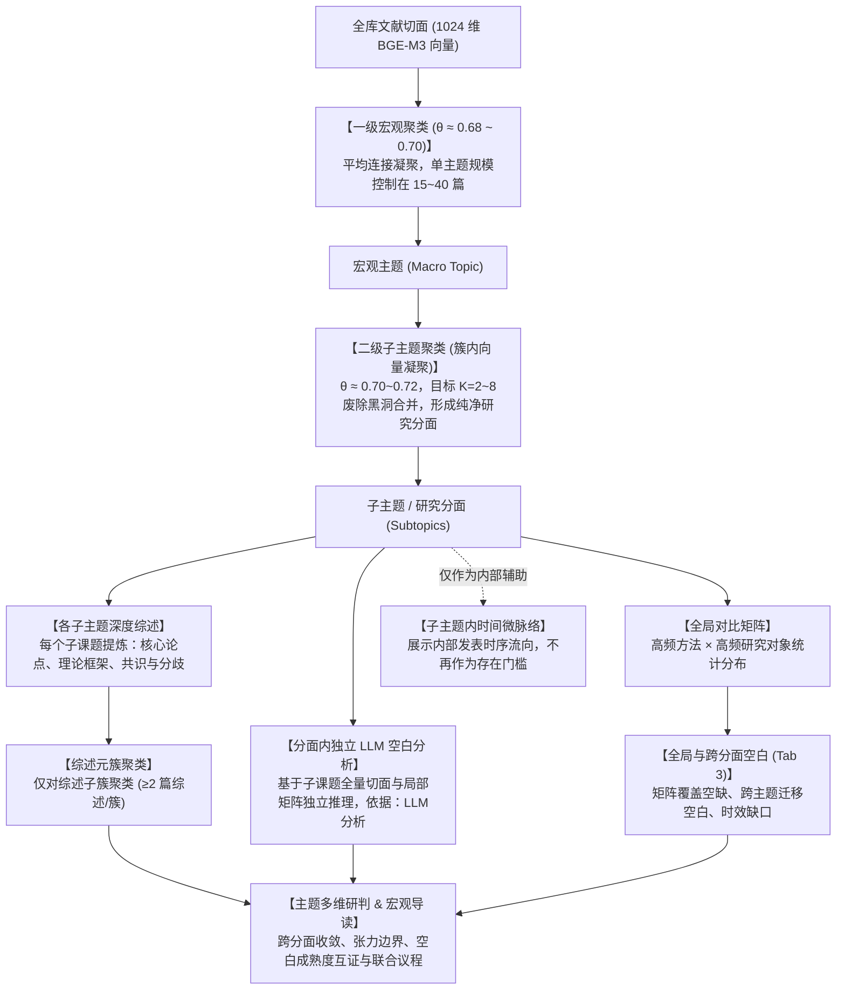
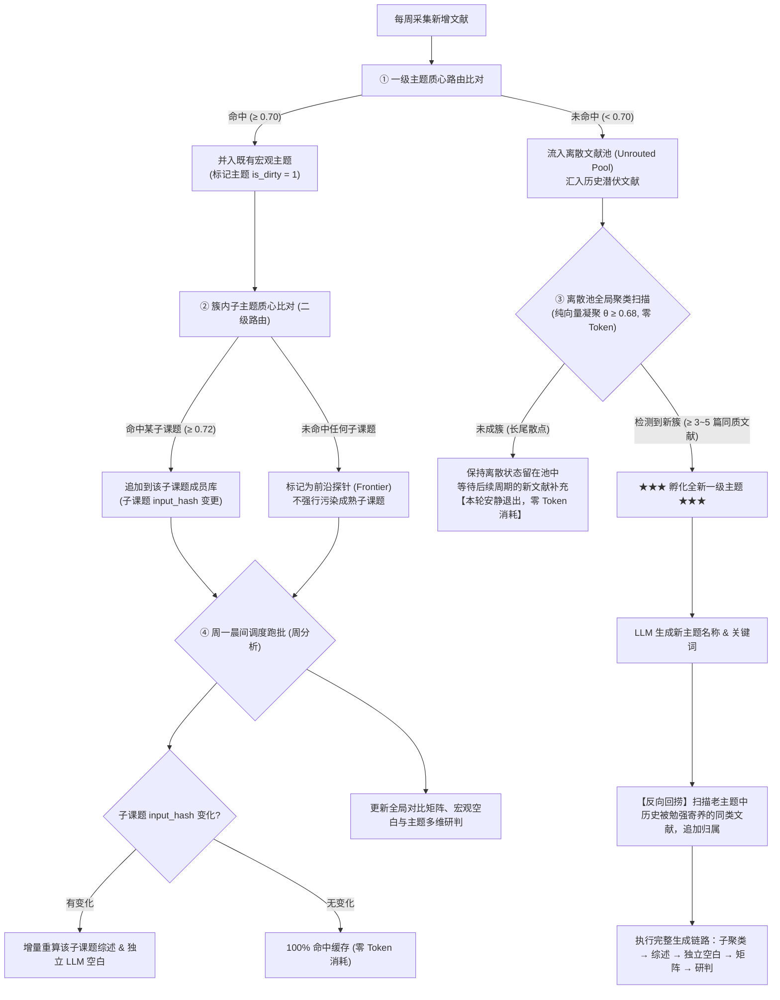

# 主题聚类与洞察重构方案：分层语义聚簇与增量演进

| 属性 | 内容 |
|---|---|
| 文档版本 | v3.1 |
| 提出日期 | 2026-11-24（2026-11-25 增补 v3.1 独立空白分析与洞察联动） |
| 状态 | v3.0 主体已实施；v3.1 已实施（子主题独立 LLM 空白分析、`scope` 存储隔离、综述元簇两步挂载与主题多维研判联动均已落地） |
| 适用模块 | `src/topic-cluster/`，路由 `/clusters` |
| 关联文档 | [主题洞察模块内部逻辑总结.md](./主题洞察模块内部逻辑总结.md)、[cluster-calibration-20261123.md](./cluster-calibration-20261123.md)、[主题洞察重建脚本使用说明.md](./主题洞察重建脚本使用说明.md) |
| 核心目标 | 废弃导致流水账的“硬性时间演进脉络主导”机制，重构为“分层语义向量聚簇主导”，实现高纯度子主题切分、子主题独立 LLM 空白分析与综述联动、自底向上主题多维研判、前沿文献离散池自动涌现 |

---

## 1. 背景与核心病灶诊断

### 1.1 现状表现与痛点
在现有系统使用中，用户与测试反馈集中在以下严重体验缺陷：
1. **“演进脉络”沦为大杂烩流水账**：
   一个大主题（如《数智时代图书馆转型与智慧服务创新》）下混入了编目、数据中台、智库建设、智能咨询等完全不同领域的文献。时间线将它们生硬拼凑，LLM 只能输出泛化平铺的宏观流水账，没有学术演进价值。
2. **绝大多数角度沦为无意义降级**：
   前端频繁出现提示：`该子域未识别出连续承接段（至少 3 篇），以下先呈现质心代表文献；展开可查看全部成员。`，全库高达 **73%** 的角度被判定为无法成链的发散状态（`divergent`）。
3. **子群综述与研究空白脱节**：
   子群综述抽取了 11 篇文献进行长文写作，但读者在当前界面看不到任何可落地的“研究空白（Gaps）”。

---

### 1.2 根因定位与数据事实

通过全库 **930 篇文献切面（431,985 个文献对）** 的离线校准与代码断点追踪，确认了深层技术根因：

#### A. 为什么不能直接将阈值调高到 0.75？
实测全库 BGE-M3 向量相似度分布：
- **P50 中位数**：仅 **0.560**；**P90**：**0.657**；两两相似度 $\ge 0.75$ 的文献对在全库仅占 **1.5%**。
- **阈值敏感度测试（平均连接凝聚 UPGMA）**：
  - $\theta = 0.65$（原默认）：最大主题被强行吸入 **156 篇**，簇内最小相似度跌破 **0.49**，导致大杂烩。
  - $\theta = 0.70$（推荐平衡点）：成簇 78 个，最大簇降至 38 篇，簇内最小两两相似度提升至 **0.63**，主题纯净度高。
  - $\theta = 0.75$：**噪声丢弃 668 篇（占全库 71.8%！）**，系统出现大面积空仓瘫痪。

#### B. 为什么 156 篇文献会被并成唯一的 1 个角度？（代码级黑洞合并 Bug）
在 [`src/topic-cluster/domain/chaining.ts:groupAngles`](file:///f:/Github/lis-rss-daily/src/topic-cluster/domain/chaining.ts#L108) 中：
- 设定的角度切分阈值 `angleThreshold = 0.82`。由于实际相似度极少能到 0.82，初始平均连接凝聚产生了 **136 个散碎单点**。
- 随后执行了 `mergeUntilLimit` 强行合并到目标 10 个角度内。由于大簇合并后质心最接近中心，形成了**滚雪球黑洞效应**：大簇一步步吞掉所有单点，**最终把 156 篇文献全部并进了同一个角度**。

#### C. 为什么大多角度显示“未识别出连续承接段”？
在 `buildSteps` 中，承接关系判定（`relation = 'continue'`）条件极度苛刻：要求方法和对象同时相同（`sharedMethod && sharedObject`）或余弦相似度 $\ge 0.88$（全库概率仅 0.004%），且时间精度不同直接一票否决。中小型主题根本无法凑齐 3 篇连续承接，直接大面积降级。

#### D. 为什么综述看不到研究空白？
在前端布局中，深度综述位于 **Tab 1（综述与洞察）**；而研究空白（Gaps）被放在了 **Tab 2（方法 × 对象矩阵与空白）** 下。虽然数据库中存在 12 条高质量空白，但 UI 割裂导致体感断层。

---

## 2. 核心重构思想：从“脉络主导”到“分层语义聚簇主导”

学术文献的自然规律是**按研究专题（语义簇）聚集**的，强求线性时间传承链违背了学术实际。重构后的核心原则为：

1. **确定性语义分层**：
   - **宏观一级**：全局主题聚类（控制在 15~40 篇），形成清晰的研究大方向。
   - **微观二级**：主题内部纯向量二次聚类（切分为 3~8 个子课题），形成同质专门研究分面。
2. **结构化知识自底向上提炼**：
   - **子课题级**：生成独立深度综述 + 本子课题内部研究局限与空白。
   - **全局级**：全景对比矩阵（方法 × 对象）+ 跨子课题迁移空白 + 全局宏观综述与战略洞察。
3. **时序演进降级为辅助微视图**：
   - 彻底废除“根据能否连成时间线决定子域存亡”的机制。
   - 子课题的存在由语义向量聚类保证；时序演进仅在同子课题内部作为可选流向参考展示。

---

## 3. 分层聚类与知识提炼架构拓扑



---

## 4. 详细算法设计与实现规范

### 4.1 一级聚类（宏观主题）阈值调优
- **配置变更**：
  ```ts
  CLUSTER_INIT_THRESHOLD = 0.68; // 推荐 0.68~0.70，打破 156 篇大桶
  CLUSTER_SIM_THRESHOLD = 0.70;  // 增量路由阈值同步调整
  ```
- **预期收益**：杜绝百篇级“超级杂烩主题”，使一级主题粒度回归健康（20~50 篇）。

---

### 4.2 二级聚类（研究分面 / 子主题）算法重构
彻底废弃原 `groupAngles` 中带有黑洞吞并效应的 `mergeUntilLimit`，改为受控的**簇内平均连接凝聚**：

```ts
export interface SubtopicGroup {
  subtopicKey: string;
  label: string | null;
  members: ChainItem[];
  centroid: Float32Array;
}

export function groupSubtopics(
  items: ChainItem[],
  subtopicThreshold: number = 0.70,
  options: SubtopicOptions = {}
): SubtopicGroup[] {
  if (items.length === 0) return [];

  const maxCount = options.maxSubtopics ?? options.maxAngleCount ?? 8;
  const targetCount = clamp(Math.ceil(items.length / 8), 2, maxCount);
  const minSize = 2; // 最少 2 篇成簇

  // 1. 簇内纯向量平均连接凝聚
  const { components, noiseIds } = cohesionClusters(
    items.map(m => ({ id: m.articleId, vector: m.vector })),
    subtopicThreshold,
    { minSize, linkage: 'average', targetCount, cutSimilarityFloor: Math.min(subtopicThreshold, 0.68) }
  );

  // 2. 离散点/极小簇就近吸收（寻找最近质心，但绝不滚雪球吞并）
  const subtopics = formBalancedSubtopics(components, noiseIds, items, maxCount, targetCount);

  // 3. 身份平滑继承（基于历史 Jaccard 相似度，防止周度跑批时 Key 与 Label 乱漂）
  assignStableIdentities(subtopics, options.previous ?? []);

  return subtopics;
}
```

**簇内实测验证**：
对主题 #97（156 篇）在 $\theta = 0.70$ 下实测，成功切分出 **11 个语义高度同质的专门子课题**：
- **子课题 A (27 篇)**：高校智慧图书馆未来学习中心与跨模态场景创新（#155, #397, #856...）
- **子课题 B (19 篇)**：面向学科交叉融合的数字资源供给体系（#120, #138, #168...）
- **子课题 C (17 篇)**：公共图书馆高质量发展与“十五五”战略规划（#171, #172, #173...）
- **子课题 D (10 篇)**：多模态文化遗产智能问答与语义组织（#133, #162, #1767...）

---

### 4.3 产出层重构：分层生成与 UI 同屏联动

| 层级 | 模块名称 | 职责与产出物 | 对应数据表 / 字段 |
|---|---|---|---|
| **子课题级 (局部)** | **子课题深度综述** | 提炼该专题的核心论断、理论框架、共识与争议分歧 | `cluster_topic_reviews` |
| **子课题级 (局部)** | **分面局限与空白（独立 LLM 分析）** | 按子课题全量成员切面与局部矩阵独立推理可检验研究空白（`scope = 'subtopic'`、`basis = 'llm_analysis'`），与综述同屏呈现 | `cluster_topic_gaps` (`subtopic_key`, `scope`) |
| **全局主题级 (宏观)** | **对比矩阵** | 统计全主题的“方法 × 对象”二维分布 | `cluster_topic_analysis.matrix_json` |
| **全局主题级 (宏观)** | **跨分面与跨主题空白 (Tab 3)** | 识别全局方法×对象空缺（`matrix_hole`）、跨主题迁移（`cross_topic_gap`）与时效缺口（`staleness`） | `cluster_topic_analysis.gaps` / `cluster_topic_gaps` (`scope = 'topic'`) |
| **主题内综合级** | **宏观导读与主题多维研判** | 先聚综述元簇再挂载分面/宏观空白，做跨子课题收敛、张力、空白成熟度互证与联合议程 | `cluster_topic_analysis.overview` & `cluster_insight_reports` |

---

### 4.4 子主题独立研究空白分析与「主题多维研判」联动升级（v3.1 最佳实践）

#### 一、为什么要从“宏观空白规则切片”升级为“子主题独立 LLM 分析”？
v3.0 初版采用“主题级阶段 B 生成 ≤12 条空白 → `gap-materializer.ts` 按规则挂到 `subtopic_key`”的模式，存在四项结构性缺陷：
1. **全局配额稀释小分面**：整个宏观主题空白上限 `MAX_GAPS = 12`，热门子课题占满后，冷门子课题往往分不到空白；且 `linked_count < 6` 的小主题跳过阶段 B，导致有子群综述却 0 空白。
2. **输入截断导致视野失真**：主题级分析受 24k 字符与 40 篇全局样本预算限制，单篇 `limitation` 被压缩至 50~70 字，模型看不到各子课题的完整边界与局部空缺。
3. **身份漂移风险**：综述表增量续写会保留历史 `review_key`，而 `gap-materializer.ts` 无历史上下文重算 `a-<hash>`，多轮增量后可能出现 `subtopic_key` 失配。
4. **职责混淆**：同一子课题下的空白与综述割裂，既未利用综述的局部上下文，也与综述手风琴内的 `sections.limitations` 缺乏分工。

#### 二、子主题独立空白分析规范（分面级）
在 [`src/topic-cluster/service/review-runner.ts`](file:///f:/Github/lis-rss-daily/src/topic-cluster/service/review-runner.ts) 中，对每个 `input_hash` 发生变更的子课题，在深度综述之后**独立执行一次专门的研究空白分析 LLM 调用**（与 `cluster_deep_review` 解耦，避免长文综述 7 个小节与结构化空白争抢 `maxTokens` 导致截断）：

1. **输入构造（全量覆盖 + 零 Token 局部信号）**：
   - **全量成员轻量切面**：突破 `reviewEvidenceCap = 18` 与全局 40 篇上限，提取该子课题**全部成员**的 `articleId`、`title`、`year`、`method`、`studyObject`、`coreFinding` 与完整 `limitation`（不携带 800 字 `summaryExcerpt`，控制输入体量）。
   - **局部矩阵与分布**：对该子课题成员直接调用零 Token 的 `buildMatrix` 计算局部高频方法/对象及空缺格（若子课题仅 2~5 篇不足以成矩阵，回退为方法/对象频次统计）。
   - **综述上下文与分工**：传入刚生成的子课题综述 `title` 与 `abstract`；Prompt 中明确分工——综述正文 `sections.limitations` 侧重段落式归纳文献已提及的不足，独立空白分析输出 **2~3 条结构化、可检验、面向后续实验/研究设计的研究空白**。
2. **防幻觉白名单与输出契约**：
   - 继续沿用 `filterAllowedIds(evidence_article_ids, subtopicMemberIds)` 强校验，**无有效文献回链的空白整条丢弃**，杜绝泛化 AI 套话。
   - `basis` 统一记为 `'llm_analysis'`，`subtopic_key` 严格写入 `group.subtopicKey`，彻底消除规则重算导致的 Key 漂移。
3. **存储隔离与前端呈现**：
   - 在 `cluster_topic_gaps` 表增加 `scope` 字段区分来源：`'subtopic'`（子课题独立 LLM 分析）与 `'topic'`（阶段 B 宏观空白）。
   - `gap-materializer.ts` 仅替换 `scope = 'topic'` 行；`review-runner.ts` 按 `(topic_id, subtopic_key)` 局部替换 `scope = 'subtopic'` 行，**两套链路互不覆写**。
   - 前端 [`tab-synthesis.js`](file:///f:/Github/lis-rss-daily/src/public/js/cluster-detail/tab-synthesis.js) 在「本分面局限与研究空白」优先渲染 `scope = 'subtopic'` 空白；[`utils.js`](file:///f:/Github/lis-rss-daily/src/public/js/cluster-detail/utils.js) 将 `basis = 'llm_analysis'` 映射为 **`依据：LLM分析`**，并保留右侧可展开的 **`依据 N 篇文献`** 文献溯源抽屉。
   - 宏观 Tab 3「矩阵与空白」继续展示主题级 `analysis.gaps`（`matrix_hole` / `cross_topic_gap` / `staleness`），实现**局部 LLM 深挖 + 全局跨分面互补**的分层布局。

#### 三、「主题多维研判」联动升级规范（跨分面级）
将子课题独立 LLM 空白纳入 [`src/topic-cluster/service/insight-builder.ts`](file:///f:/Github/lis-rss-daily/src/topic-cluster/service/insight-builder.ts) 作为「主题多维研判」（`cluster_insight_reports`）的输入，用于跨子课题互证空白成熟度（`gap_maturity`）与提炼共性议程，同时必须同步修正原聚类与配额瓶颈：

1. **聚类解耦（先聚综述元簇，再挂载空白）**：
   - **废弃「综述与空白混池聚类」**：若直接将每个子课题 2~3 条空白混入 `cohesionClusters`，空白节点数会达到综述数的 3~5 倍，极易切出“1 个综述 + 多条空白”的无效簇并被 `reviewNodes.length < 2` 静默丢弃。
   - **改为两步挂载**：先**仅对 `cluster_topic_reviews` 聚出元簇**（保证每簇 ≥ 2 篇综述）；再按 `subtopic_key` 把成员综述所属的 `scope = 'subtopic'` 空白精确挂入元簇，并将 `scope = 'topic'` 宏观空白按向量相似度挂载到最邻近元簇。
    - 适度放宽 [`src/topic-cluster/llm/insight.ts`](file:///f:/Github/lis-rss-daily/src/topic-cluster/llm/insight.ts) 中 `parseGapMaturity` 的截断上限（由 8 条提升至 `CLUSTER_LIMITS.insightGapCap = 16` 条）。
2. **输入去重与来源标明**：
   - 传给 `cluster_insight` 的 `GAPS_JSON` 增加 `scope` 与所属综述/子课题标识（`sourceReviewId` / `subtopicTitle`），让模型明确知道每条空白是由哪个分面提出的。
   - 相应精简 `toReviewInput` 传入 `REVIEWS_JSON` 的内容，聚焦 `researchQuestions`、`theoreticalBasis`、`methodsAndData`、`findings` 与 `debates`，减少与结构化 `GAPS_JSON` 的内容重复。
3. **提示词逻辑升级（[`cluster_insight.md`](file:///f:/Github/lis-rss-daily/src/config/default-prompts/cluster_insight.md)）**：
   - **跨分面互证 `gap_maturity`**：若子课题 A 提出的 `llm_analysis` 空白已被同主题内子课题 B 的研究发现或方法实质回应，判为 `closing` 并明确引用对应 `review_ids`；若多个子课题均受同一瓶颈制约且尚无分面解决，判为 `unaddressed`。
   - **共性议程升维**：指导 `agenda` 合并跨分面相似瓶颈，输出主题级联合研究设计，而非逐条复述单分面空白。
4. **缓存联动与展示细节**：
   - [`insight-runner.ts`](file:///f:/Github/lis-rss-daily/src/topic-cluster/service/insight-runner.ts) 的 `computeReportHash` 自动纳入入簇分面空白的文本与指纹，子课题空白更新时自动触发对应研判重算；仅有 1 个综述子簇的小主题保持跳过研判（`insightMinReviews = 2`），在子群卡片下直接呈现空白即可。
   - （可选体验增强）在研判报告的 `综述 #id` / `空白 #id` 引用标签上补充悬停文本提示，方便读者直接对照。

---

## 5. 增量文献与离散文献池的周度闭环生命周期



### 增量运行原则说明：
1. **就近归队与前沿隔离**：新文献进入大主题后，优先归入对应子课题；无匹配者归为 `frontier`，防止破坏成熟子课题结构。
2. **离散池全局零成本探查**：离散池每周通过纯向量计算检测新簇，若无新簇形成，**毫秒级直接退出，消耗 0 个 LLM Token**。
3. **破土涌现与反向回捞**：一旦离散池累积满 3~5 篇同质文献，自动生成新主题，并通过质心反向扫描全库，找回历史寄养在其他主题的文献。
4. **子主题级别增量缓存**：每周只对有文献或切面变动的子课题重写综述与独立空白分析，无变动的成熟子课题永久命中缓存；主题多维研判随入簇综述与空白指纹联动增量重算。

---

## 6. 实施路线与行动清单

### 第一阶段：算法层改造（零 Token）
- [x] 修改 [`src/topic-cluster/config.ts`](file:///f:/Github/lis-rss-daily/src/topic-cluster/config.ts) 与 [`src/config.ts`](file:///f:/Github/lis-rss-daily/src/config.ts)：校准 `CLUSTER_INIT_THRESHOLD`（0.68）与 `CLUSTER_SIM_THRESHOLD`（0.70）。
- [x] 重构 [`src/topic-cluster/domain/chaining.ts`](file:///f:/Github/lis-rss-daily/src/topic-cluster/domain/chaining.ts)：废除黑洞吞并逻辑，实现稳定的子主题二次聚类 `groupSubtopics`。
- [x] 改造 [`src/topic-cluster/service/thread-builder.ts`](file:///f:/Github/lis-rss-daily/src/topic-cluster/service/thread-builder.ts)：将 `topic_threads` 降级为辅助时序呈现，允许无连续承接段的子课题完整保留并展示。

### 第二阶段：服务与分析流水线改造
- [x] 重构 [`src/topic-cluster/service/review-builder.ts`](file:///f:/Github/lis-rss-daily/src/topic-cluster/service/review-builder.ts)：使 `cluster_topic_reviews` 1:1 严格对齐二次聚类划分出的子课题分面。
- [x] 重构 [`src/topic-cluster/service/gap-materializer.ts`](file:///f:/Github/lis-rss-daily/src/topic-cluster/service/gap-materializer.ts)：记录研究空白所属的子课题归属，实现局部空白关联。
- [x] 校验 [`src/topic-cluster/pipeline/incubate.ts`](file:///f:/Github/lis-rss-daily/src/topic-cluster/pipeline/incubate.ts) 与 [`reclaim.ts`](file:///f:/Github/lis-rss-daily/src/topic-cluster/pipeline/reclaim.ts)：确保离散池周度成簇检测与反向回捞协同运作。

### 第三阶段：前端 UI 同屏联动呈现
- [x] 改造 [`src/public/js/cluster-detail/tab-synthesis.js`](file:///f:/Github/lis-rss-daily/src/public/js/cluster-detail/tab-synthesis.js)：在每个“子群深度综述”卡片下方，直接呈现该子课题归属的“局限性与研究空白”，实现同屏联动。
- [x] 改造 [`src/public/js/cluster-detail/tab-evolution.js`](file:///f:/Github/lis-rss-daily/src/public/js/cluster-detail/tab-evolution.js)：移除“未识别出连续承接段”的降级文案，将各子课题全量成员平滑展示，并标注时序流向。

### 第四阶段：子主题独立 LLM 空白分析与洞察联动升级（v3.1）
- [x] 数据库与仓储隔离：新增迁移（为 `cluster_topic_gaps` 增加 `scope` 列区分 `'topic'` / `'subtopic'`），改造 [`src/topic-cluster/repo/gaps.ts`](file:///f:/Github/lis-rss-daily/src/topic-cluster/repo/gaps.ts) 与 [`src/topic-cluster/service/gap-materializer.ts`](file:///f:/Github/lis-rss-daily/src/topic-cluster/service/gap-materializer.ts)，实现宏观空白与子主题空白按 `scope` 独立替换、互不覆盖。
- [x] 子主题独立空白分析：新增提示词模板并在 [`src/api/system-prompts.ts`](file:///f:/Github/lis-rss-daily/src/api/system-prompts.ts) / [`src/config/system-prompt-variables.ts`](file:///f:/Github/lis-rss-daily/src/config/system-prompt-variables.ts) 注册；在 [`src/topic-cluster/service/review-runner.ts`](file:///f:/Github/lis-rss-daily/src/topic-cluster/service/review-runner.ts) 中基于子课题全量切面、局部矩阵及综述摘要独立调用 LLM 生成 `basis = 'llm_analysis'` 空白（复用子课题 `input_hash` 增量缓存，并结合 [`src/topic-cluster/util/pool.ts`](file:///f:/Github/lis-rss-daily/src/topic-cluster/util/pool.ts) 控制并发）。
- [x] 主题多维研判联动：改造 [`src/topic-cluster/service/insight-builder.ts`](file:///f:/Github/lis-rss-daily/src/topic-cluster/service/insight-builder.ts) 为“先仅对 `reviews` 聚元簇、再按 `subtopic_key` 与质心挂载 `subtopic`/`topic` 空白”；升级 [`src/topic-cluster/llm/insight.ts`](file:///f:/Github/lis-rss-daily/src/topic-cluster/llm/insight.ts)（增加 `scope` / `sourceReviewId`、放宽 `parseGapMaturity` 截断上限至 `CLUSTER_LIMITS.insightGapCap = 16`）与 [`src/config/default-prompts/cluster_insight.md`](file:///f:/Github/lis-rss-daily/src/config/default-prompts/cluster_insight.md)（跨分面互证成熟度与共性议程升维）。
- [x] 查询与前端适配：调整 [`src/topic-cluster/query.ts`](file:///f:/Github/lis-rss-daily/src/topic-cluster/query.ts) 优先按 `scope = 'subtopic'` 挂载子群空白；在 [`src/public/js/cluster-detail/utils.js`](file:///f:/Github/lis-rss-daily/src/public/js/cluster-detail/utils.js) 的 `BASIS_LABELS` 新增 `llm_analysis: '依据：LLM分析'`，并在 [`src/public/css/pages/clusters/tabs/tab-matrix.css`](file:///f:/Github/lis-rss-daily/src/public/css/pages/clusters/tabs/tab-matrix.css) 补充 `.basis-llm_analysis` 徽章样式。
